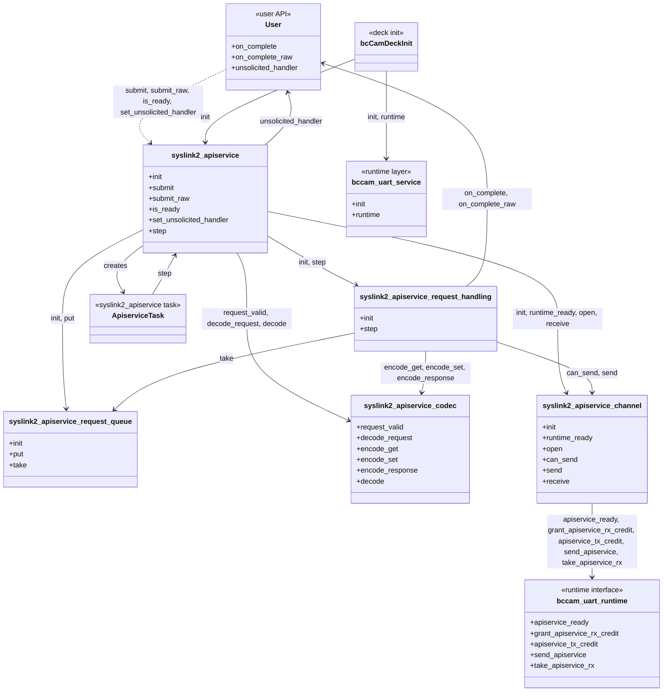
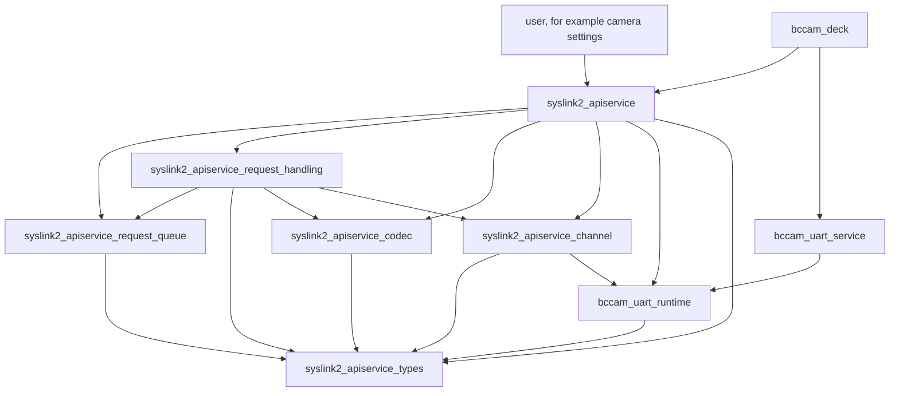
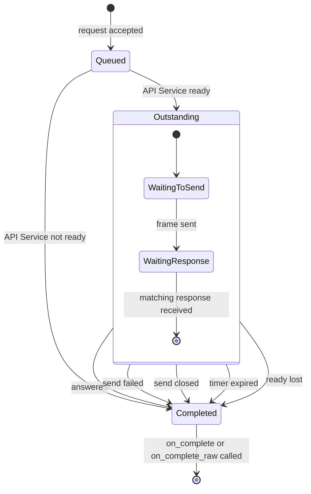
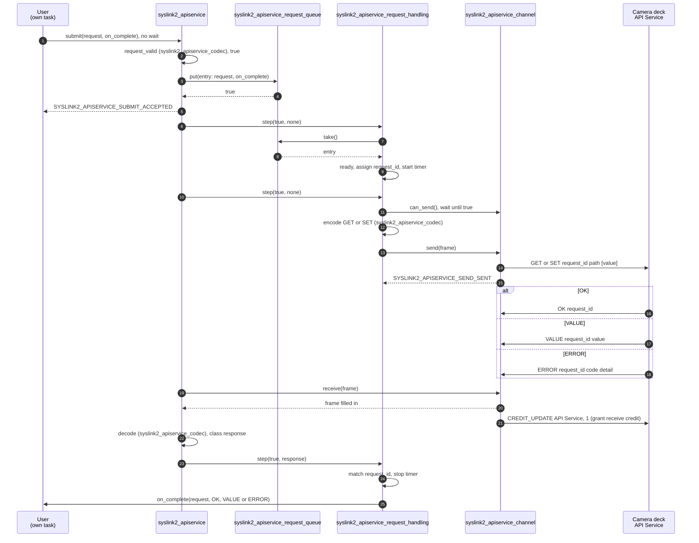
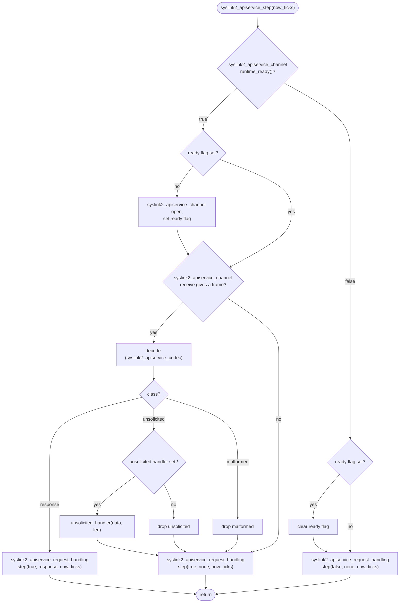
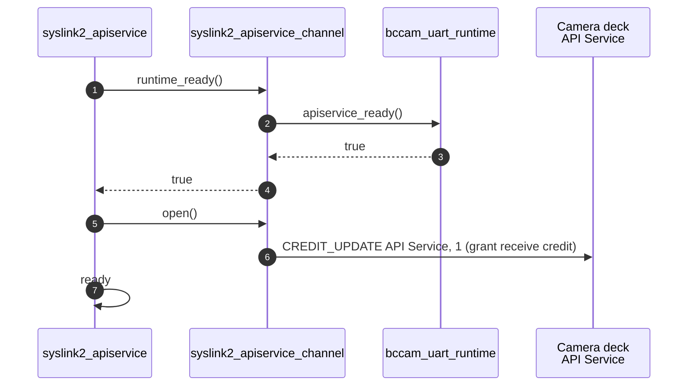
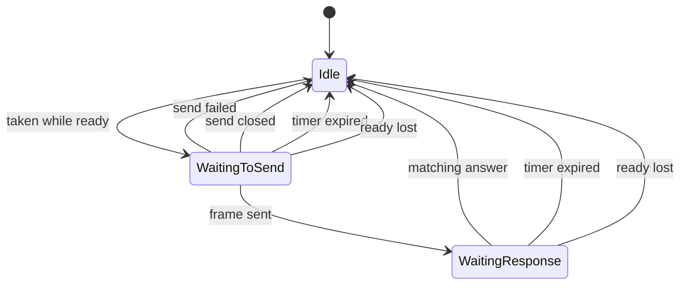
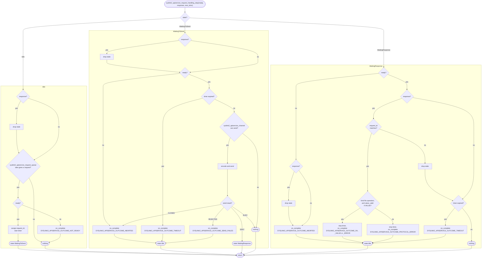
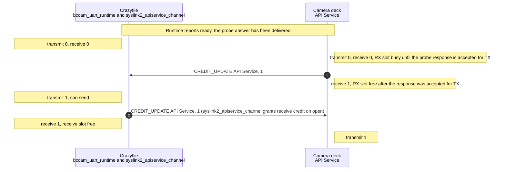

Design of the API Service on the Crazyflie side of the UART link to the
camera deck.

The wire format is defined by the API Service protocol in
camera-deck-firmware (`docs/protocol/common/apiservice.md`). This page
summarizes the layout of the frames in scope, see [Frame layout](#frame-layout). Where they
differ, the protocol document is the authority.

## Scope

In scope, matching `bitcraze.api` version 0.0 on the deck:

- the requests `GET` and `SET`,
- the responses `OK`, `VALUE` and `ERROR`,
- the value types `bool`, `u8`, `i8`, `u16`, `i16`, `u32` and `i32`,
- one request outstanding at a time,
- recognizing unsolicited frames from the deck, such as `NOTIFY`, and passing
  them to the unsolicited handler, or dropping them when none is set, see
  [Frame classes](#frame-classes).

Out of scope: `CMD`, decoding `NOTIFY`, more than one request in flight,
path handles, listing paths and chunking. The probe is also out of scope.
The runtime runs it before the API Service takes over, see
[Ready](#ready).

## Terms

The terms build on Frame-Slot Credit in the Common Link. Credit is per
service and per direction. Here they are used for the API Service, seen
from the Crazyflie.

- **Frame**: one API Service message, the payload of one UART packet on the
  API Service. The runtime removes the UART packet envelope, so a frame
  starts with `kind`. A frame has no length field of its own. Its length is
  the UART packet's `payload_length`, at most the Link MTU. See "Frame
  layout".
- **Transmit credit**: Frame-Slot Credit the deck has given the Crazyflie.
  One credit allows the Crazyflie to send one API Service frame.
- **Receive credit**: Frame-Slot Credit the Crazyflie has given the deck.
  One credit allows the deck to send one API Service frame.
- **Receive slot**: local space for one received API Service frame. Receive
  credit is never more than the number of free receive slots.
- **Grant receive credit**: the Crazyflie makes a free receive slot
  available to the deck. Freeing the slot and telling the deck always happen
  together.
- **Bound**: the API Service is bound when the catalog advertises a
  compatible `bitcraze.api` and the Crazyflie has taken its handle. This
  is Service Binding in the Common Link.
- **Ready**: the API Service is bound and the probe has been answered
  with `VALUE`. User requests are only transmitted while ready.
- **Deck request ID**: the `request_id` on the wire between the Crazyflie
  and the deck. Owned by the API Service, which assigns it. Users never
  see it.
- **User request ID**: the request ID between a user and the Crazyflie.
  Owned by the user, which assigns it. The API Service does not read it
  and returns it with the result. For example, a user submits user request
  ID 2, the API Service sends it to the deck as deck request ID 8, the
  deck answers 8, and the user gets the completion for user request ID 2.
- **Raw request**: a user request given as bytes, laid out as a `GET` or
  `SET` frame, see [Frame layout](#frame-layout). Its `request_id` byte
  holds the user request ID, not the deck request ID. A raw request is
  submitted with `syslink2_apiservice_submit_raw` and decoded into a
  `syslink2_apiservice_request_t` before it is queued. It completes with
  `on_complete_raw`.
- **Raw response**: the answer to a raw request given as bytes, laid out as
  an `OK`, `VALUE` or `ERROR` frame, see [Frame layout](#frame-layout). Its
  `request_id` byte holds the user request ID, not the deck request ID. It
  is passed to `on_complete_raw`, see [Raw responses](#raw-responses).
- **Completion**: the one call that tells the user that a request has
  completed: `on_complete` for a request from
  `syslink2_apiservice_submit`, `on_complete_raw` for a raw request.
- **Probe**: the `GET 0 meta.schema_modules` request the runtime sends on
  the API Service before ready. The API Service only observes the
  result.
- **Lifecycle**: the states of something that is created and ends, and goes
  through them once, such as a request from `syslink2_apiservice_submit`
  to its completion.
- **State machine**: the states of something that lives as long as the
  system and moves between them repeatedly, such as
  `syslink2_apiservice`.
- **Unit**: one `.c` and `.h` pair with its own interface and its own host
  test. The API Service layer consists of units.

### Frame layout

Every frame in scope starts with the same two bytes, followed by a body that
depends on `kind`:

| Byte | Field | Content |
|---|---|---|
| 0 | `kind` | `GET` 0x01, `SET` 0x02, `OK` 0x80, `VALUE` 0x81, `ERROR` 0x82. Bit 7 is set in frames from the deck. |
| 1 | `request_id` | The deck request ID. Set by the Crazyflie in the request, copied by the deck into the answer. |
| 2.. | body | Depends on `kind`, see below. |

Bodies:

| `kind` | Body |
|---|---|
| `GET` | `path_len:u8`, `path` |
| `SET` | `path_len:u8`, `path`, `value` |
| `OK` | empty |
| `VALUE` | `value` |
| `ERROR` | `error_code:u8`, `detail_len:u8`, `detail` |

- `value` is `type:u8`, `len:u8`, `data[len]`. Multi-byte integers are
  little-endian.
- The value types in scope and their type codes: `bool` 0x01, `u8` 0x10,
  `i8` 0x11, `u16` 0x12, `i16` 0x13, `u32` 0x14 and `i32` 0x15.
- `path` is ASCII, `path_len` bytes, not NUL-terminated.
- A response shorter than 2 bytes has no `request_id` and is malformed.

### Frame classes

`syslink2_apiservice_codec` sorts every received frame into one of three classes
by its `kind`, using the ranges of the message-kind allocation in the
protocol:

| Class | `kind` |
|---|---|
| Response | `OK`, `VALUE` or `ERROR` (in 0x80..0xbf), with a body that matches [Frame layout](#frame-layout)
| Unsolicited | 0xc0..0xff, for example `NOTIFY`. |
| Malformed | Everything else |

## Layers

A layer is a level of the design with its own responsibility. It talks only
to the layer directly above and the layer directly below, through a defined
interface.

| Layer | Responsibility | Scope |
|---|---|---|
| Users, for example camera settings | Decide what to `GET` and `SET` | Out of scope. Only the API they call is defined. |
| API Service | Turns user requests into API Service frames and back. Handles readiness, timeouts and credit. | In scope |
| Runtime and Common Link | Bytes, frames, session, catalog, Service Binding, credit accounting and the probe | Out of scope. Only the interface the API Service uses is defined. |

This page describes the API Service layer and its two interfaces: the
user API above and the runtime interface below.

The API Service runs in a task of its own, the API Service task, see [API Service
task](#api-service-task). `syslink2_apiservice_init` is called from the deck
init, `bcCamDeckInit` in `bccam_deck`, after `bccam_uart_service_init`, and
creates the API Service task.

## Units

The API Service is broken down into five units by responsibility.
`syslink2_apiservice` is above the other four and coordinates them.

| Unit | Responsibility |
|---|---|
| [`syslink2_apiservice`](#syslink2_apiservice) | The unit that holds all public functions of the API Service. Owns the API Service task, which steps it. Holds the ready flag. Tells the other units what to do in a fixed order. Receives frames, passes responses on to `syslink2_apiservice_request_handling` and unsolicited frames to the unsolicited handler. |
| [`syslink2_apiservice_request_queue`](#syslink2_apiservice_request_queue) | Hands submitted requests from user tasks to the API Service task. |
| [`syslink2_apiservice_request_handling`](#syslink2_apiservice_request_handling) | Handles one outstanding request. |
| [`syslink2_apiservice_codec`](#syslink2_apiservice_codec) | Library of functions for encoding, decoding and validation. |
| [`syslink2_apiservice_channel`](#syslink2_apiservice_channel) | Handles transmit and receive, and its allowance; the only unit aware of the receive slot and credit. The only unit that calls the runtime. |

The sections from [Structure](#structure) to [Error handling](#error-handling) cover more
than one unit. Each unit then has its own section.

## Structure

The units, the user API above them and the runtime interface below them.

The diagrams show functions by their name without the unit prefix: for example, `submit`
in `syslink2_apiservice` is `syslink2_apiservice_submit`. Functions are represented by
their names only. The signatures and fields are in [User API](#user-api), [Runtime interface](#runtime-interface) and each
unit's section.



The data passed through the user API, and the frame and response passed
between the units:

```mermaid
classDiagram
    direction LR

    class syslink2_apiservice_frame_t {
        uint8_t data[SYSLINK2_APISERVICE_FRAME_MAX_LEN]
        uint8_t len
    }
    note for syslink2_apiservice_frame_t "SYSLINK2_APISERVICE_FRAME_MAX_LEN = 64"

    class syslink2_apiservice_request_t {
        uint8_t operation GET or SET
        uint8_t user_request_id
        char path[SYSLINK2_APISERVICE_PATH_MAX_LEN]
        uint8_t path_len
        syslink2_apiservice_value_t value
    }
    note for syslink2_apiservice_request_t "SYSLINK2_APISERVICE_PATH_MAX_LEN = 55"

    class syslink2_apiservice_queue_entry_t {
        syslink2_apiservice_request_t request
        syslink2_apiservice_on_complete_t on_complete
        syslink2_apiservice_on_complete_raw_t on_complete_raw
    }

    class syslink2_apiservice_response_t {
        uint8_t kind OK, VALUE or ERROR
        uint8_t request_id
        syslink2_apiservice_value_t value
        bool value_valid
        uint8_t error_code
        char detail[SYSLINK2_APISERVICE_DETAIL_MAX_LEN]
        uint8_t detail_len
    }
    note for syslink2_apiservice_response_t "SYSLINK2_APISERVICE_DETAIL_MAX_LEN = 60"

    class syslink2_apiservice_on_complete_t {
        <<function pointer>>
        (const syslink2_apiservice_request_t *request, const syslink2_apiservice_result_t *result) void
    }

    class syslink2_apiservice_on_complete_raw_t {
        <<function pointer>>
        (syslink2_apiservice_outcome_t outcome, uint8_t user_request_id, const uint8_t *data, uint8_t len) void
    }

    class syslink2_apiservice_unsolicited_fn {
        <<function pointer>>
        (const uint8_t *data, uint8_t len) void
    }

    class syslink2_apiservice_result_t {
        syslink2_apiservice_outcome_t outcome
        syslink2_apiservice_value_t value
        uint8_t error_code
    }

    class syslink2_apiservice_outcome_t {
        <<enumeration>>
        SYSLINK2_APISERVICE_OUTCOME_OK
        SYSLINK2_APISERVICE_OUTCOME_VALUE
        SYSLINK2_APISERVICE_OUTCOME_ERROR
        SYSLINK2_APISERVICE_OUTCOME_TIMEOUT
        SYSLINK2_APISERVICE_OUTCOME_NOT_READY
        SYSLINK2_APISERVICE_OUTCOME_ABORTED
        SYSLINK2_APISERVICE_OUTCOME_PROTOCOL_ERROR
        SYSLINK2_APISERVICE_OUTCOME_SEND_FAILED
    }

    class syslink2_apiservice_submit_result_t {
        <<enumeration>>
        SYSLINK2_APISERVICE_SUBMIT_ACCEPTED
        SYSLINK2_APISERVICE_SUBMIT_QUEUE_FULL
        SYSLINK2_APISERVICE_SUBMIT_INVALID
        SYSLINK2_APISERVICE_SUBMIT_NOT_INITIALIZED
    }

    class syslink2_apiservice_value_t {
        uint8_t type
        uint8_t len
        uint8_t data[SYSLINK2_APISERVICE_VALUE_MAX_LEN]
    }
    note for syslink2_apiservice_value_t "SYSLINK2_APISERVICE_VALUE_MAX_LEN = 4"

    class syslink2_apiservice_frame_class_t {
        <<enumeration>>
        SYSLINK2_APISERVICE_FRAME_CLASS_RESPONSE
        SYSLINK2_APISERVICE_FRAME_CLASS_UNSOLICITED
        SYSLINK2_APISERVICE_FRAME_CLASS_MALFORMED
    }

    class syslink2_apiservice_send_result_t {
        <<enumeration>>
        SYSLINK2_APISERVICE_SEND_SENT
        SYSLINK2_APISERVICE_SEND_BUSY
        SYSLINK2_APISERVICE_SEND_CLOSED
        SYSLINK2_APISERVICE_SEND_REJECTED
    }

    syslink2_apiservice_result_t --> syslink2_apiservice_outcome_t
    syslink2_apiservice_request_t --> syslink2_apiservice_value_t
    syslink2_apiservice_queue_entry_t --> syslink2_apiservice_request_t
    syslink2_apiservice_queue_entry_t --> syslink2_apiservice_on_complete_t
    syslink2_apiservice_queue_entry_t --> syslink2_apiservice_on_complete_raw_t
    syslink2_apiservice_on_complete_raw_t --> syslink2_apiservice_outcome_t
    syslink2_apiservice_result_t --> syslink2_apiservice_value_t
    syslink2_apiservice_response_t --> syslink2_apiservice_value_t
```

`syslink2_apiservice_frame_t` holds one frame, including its bytes. Assumption:
the Link Maximum Transmission Unit (MTU) is 64.

- `len` is the number of valid bytes in `data`, from 0 to
  `SYSLINK2_APISERVICE_FRAME_MAX_LEN`. It replaces the UART packet's
  `payload_length`.
- `SYSLINK2_APISERVICE_FRAME_MAX_LEN` is the Link MTU of the UART profile. `len`
  fits in a `uint8_t` because the MTU is at most 255.

The other types hold their data inline, sized so that every request and
response fits in one frame:

- `SYSLINK2_APISERVICE_VALUE_MAX_LEN` is 4, the size of the largest value type in
  scope, `u32` and `i32`. `len` is the number of valid bytes in `data`.
- `SYSLINK2_APISERVICE_PATH_MAX_LEN` is 55: a `SET` frame has 2 header bytes,
  `path_len`, the path and a value of at most 2 + 4 bytes. A request with a
  longer path cannot be built. `path` is ASCII, `path_len` bytes, not
  NUL-terminated.
- `SYSLINK2_APISERVICE_DETAIL_MAX_LEN` is 60: an `ERROR` frame has 2 header bytes,
  `error_code` and `detail_len` before the detail. `detail` is UTF-8 text,
  `detail_len` bytes, not NUL-terminated.
- `syslink2_apiservice_response_t.value` and `value_valid` are valid only when
  `kind` is `VALUE`, and `error_code` and `detail` only when `kind` is
  `ERROR`. `value_valid` is false when the value fails the value checks in
  [syslink2_apiservice_codec](#syslink2_apiservice_codec). `value` must then not be
  used.
- `syslink2_apiservice_frame_class_t` is the class of a received frame, see
  [Frame classes](#frame-classes).
- `syslink2_apiservice_submit_result_t` is what `syslink2_apiservice_submit`
  and `syslink2_apiservice_submit_raw` return, see
  [syslink2_apiservice](#syslink2_apiservice).
- `syslink2_apiservice_request_t` holds only the request itself. It does not
  say who submitted it or how it completes. The path and value are copied,
  so the user can drop its request when `syslink2_apiservice_submit`
  returns.
- `syslink2_apiservice_on_complete_t` and `syslink2_apiservice_on_complete_raw_t`
  are the two kinds of completion, see [User API](#user-api). The user
  passes one of them to submit. There is no user handle and no context
  pointer: each user has its own callback, and the callback tells which user
  a request belongs to.
- `syslink2_apiservice_unsolicited_fn` is the unsolicited handler, see
  [User API](#user-api). It is defined in `syslink2_apiservice.h`, not
  in `syslink2_apiservice_types.h`.
- `syslink2_apiservice_queue_entry_t` is what the API Service keeps for a
  submitted request: the request and the callback to complete it with.
  Exactly one of `on_complete` and `on_complete_raw` is set. `on_complete_raw`
  is set for a raw request. Users never see this type.
- `user_request_id` is the user request ID. The user sets it in
  `syslink2_apiservice_request_t`, or in the `request_id` byte of a raw request,
  and the API Service does not read it. It reaches `on_complete` in the
  request copy, so `syslink2_apiservice_result_t` does not repeat it. It
  reaches `on_complete_raw` as an argument. It is not the deck request ID,
  which only `syslink2_apiservice_request_handling` knows.
- `operation` holds the wire `kind` from the protocol, `GET` 0x01 or `SET`
  0x02, see [Frame layout](#frame-layout). In the same way,
  `syslink2_apiservice_response_t.kind` holds `OK` 0x80, `VALUE` 0x81 or `ERROR`
  0x82. The constants are defined in `syslink2_apiservice_types.h`.

Which units include which. An arrow from one unit to another means that
the first unit includes the header of the other. All the types above are in
`syslink2_apiservice_types.h`, a header with no `.c` file. Standard headers such
as `stdbool.h` and `stdint.h` are left out.



- `syslink2_apiservice` and `syslink2_apiservice_channel` include
  `bccam_uart_runtime` for `bccam_uart_runtime_t`, which their init
  functions take.
- `bccam_uart_runtime` includes `syslink2_apiservice_types` for
  `syslink2_apiservice_frame_t`, which `bccam_uart_runtime_send_apiservice` and
  `bccam_uart_runtime_take_apiservice_rx` take, see
  [Runtime interface](#runtime-interface).
- Users include only `syslink2_apiservice`.
- `bccam_deck` includes `syslink2_apiservice` and `bccam_uart_service`.
  It gets the runtime instance from `bccam_uart_service` and passes it to
  `syslink2_apiservice_init`, see [Runtime interface](#runtime-interface).
- `bccam_uart_service` does not include any API Service header.
- There are no include cycles. `syslink2_apiservice_types` includes no other
  project header.

### User API

Users see only the user API: `syslink2_apiservice_submit`,
`syslink2_apiservice_submit_raw`, `syslink2_apiservice_is_ready` and
`syslink2_apiservice_set_unsolicited_handler`, see
[syslink2_apiservice](#syslink2_apiservice), their own completion
callback, which they pass to submit, and the unsolicited handler, which they
set with `syslink2_apiservice_set_unsolicited_handler`.

- `syslink2_apiservice_submit` takes a request as a
  `syslink2_apiservice_request_t` and an `on_complete`, for users such as the
  param adapter. The request completes with `on_complete`.
- `syslink2_apiservice_submit_raw` takes a [raw request](#terms) and an
  `on_complete_raw`, for users that hold the request as bytes and want the
  answer as bytes, such as a future cflib proxy. The request completes with
  `on_complete_raw`.

Everything below applies to both. "Submit" means either, and "completion"
means `on_complete` or `on_complete_raw`, whichever was passed to submit.

| Callback | What it does |
|---|---|
| `on_complete(const syslink2_apiservice_request_t *request, const syslink2_apiservice_result_t *result) void`, type `syslink2_apiservice_on_complete_t` | Tells the user that a request from `syslink2_apiservice_submit` has completed, with its result. |
| `on_complete_raw(syslink2_apiservice_outcome_t outcome, uint8_t user_request_id, const uint8_t *data, uint8_t len) void`, type `syslink2_apiservice_on_complete_raw_t` | Tells the user that a raw request has completed, with its outcome, its user request ID and, for `SYSLINK2_APISERVICE_OUTCOME_OK`, `_VALUE` and `_ERROR`, the [raw response](#terms). |
| `unsolicited_handler(const uint8_t *data, uint8_t len) void`, type `syslink2_apiservice_unsolicited_fn` | Receives each unsolicited frame from the deck, such as a `NOTIFY`. |

- The completion is called in the API Service task. It must not block.
- Every request for which submit returns
  `SYSLINK2_APISERVICE_SUBMIT_ACCEPTED` gets exactly one completion. A request
  for which it returns `SYSLINK2_APISERVICE_SUBMIT_QUEUE_FULL`,
  `SYSLINK2_APISERVICE_SUBMIT_INVALID` or `SYSLINK2_APISERVICE_SUBMIT_NOT_INITIALIZED`
  gets none. `_QUEUE_FULL` may be retried later. `_INVALID` is a bug in the
  user and must not be retried unchanged. `_NOT_INITIALIZED` means that
  `syslink2_apiservice_init` has not been called, for example because no
  camera deck is attached. A retry does not help until it has been called.
- The completion identifies the request for every outcome, also for the
  outcomes the Crazyflie produces itself:
  `SYSLINK2_APISERVICE_OUTCOME_NOT_READY`, `_ABORTED`, `_TIMEOUT`,
  `_PROTOCOL_ERROR` and `_SEND_FAILED`.
  - `on_complete` gets the copy of the whole request, including its user
    request ID. A user that needs the operation, path or value, such as the
    param adapter, does not have to keep its own table of pending requests.
    `syslink2_apiservice_request_handling` holds the copy while the request is
    outstanding anyway.
  - `on_complete_raw` gets the user request ID as `user_request_id`, and
    not the request.
- `on_complete_raw` gets the raw response in `data` and `len` only when
  `outcome` is `SYSLINK2_APISERVICE_OUTCOME_OK`, `_VALUE` or `_ERROR`. Its
  `request_id` byte equals `user_request_id`. For every other outcome the
  deck has not given a usable answer, `data` is NULL and `len` is 0. `data`
  is valid only during the call. A user that keeps the bytes copies them.
- `on_complete` gets the `ERROR` code in `syslink2_apiservice_result_t`, but not
  the detail text. `on_complete_raw` gets the detail in the raw response.
- User request IDs are separate per user. Two users can use the same user
  request ID. The API Service does not check them for uniqueness.
- A user should not reuse a user request ID while a request with it is queued
  or outstanding.
- The API Service does not check that the type of a `VALUE` is the
  type the user expects for the path. The deck is the authority on the
  type of a path. A user that expects a type checks it itself. The param
  adapter, for example, compares it with the type of the param. For `SET`,
  the deck checks the type and answers `ERROR` when it does not match,
  which gives `SYSLINK2_APISERVICE_OUTCOME_ERROR`.

The unsolicited handler:

- There is one handler for the service. It is set with
  `syslink2_apiservice_set_unsolicited_handler` at init. NULL, the
  default, drops unsolicited frames.
- It may be set after the API Service task has started. `bcCamDeckInit` calls
  `bccam_apiservice_init`, which sets it, after
  `syslink2_apiservice_init`, which creates the task. An unsolicited
  frame received before then is dropped. In practice none is: the service is
  not ready until the link session is up, and before
  `apiserviceEndpointFreeze()` the router drops notifications anyway.
- It is called in the API Service task, once for each unsolicited frame. It must
  not block.
- `data` holds the whole frame, starting with its `kind` byte, and is valid
  only during the call. A handler that keeps the bytes copies them.
- The frame is checked only for its class: at least 1 byte, with `kind` in
  0xc0..0xff, see [Received frames](#received-frames). The rest is not
  checked.
- The bcCam driver, `bccam_apiservice`, sets it and passes each frame to the
  API Service router with `apiserviceEndpointNotify()`.

### Runtime interface

The functions of the runtime that the API Service uses. They belong to
`bccam_uart_runtime`. Only `syslink2_apiservice_channel` calls them. The runtime
functions take the runtime instance, `bccam_uart_runtime_t *runtime`, as
their first argument. It is left out here. The runtime instance is
`firmware_client.runtime`, held by the `bccam_firmware_uart_client_t`
`firmware_client` in `bccam_uart_service`. `bccam_uart_service` returns it
with `bccam_uart_service_runtime() bccam_uart_runtime_t *`. `bcCamDeckInit`
passes it to `syslink2_apiservice_init`, which passes it on to
`syslink2_apiservice_channel_init`. `syslink2_apiservice_channel` stores it.

The functions are called from the API Service task, while `bcCamUartTask` uses
the same runtime and link state. Requirements on the runtime:

- All five functions are safe to call from a task other than
  `bcCamUartTask`.
- None of them blocks for longer than a short critical section.

| Function | What it does |
|---|---|
| `bccam_uart_runtime_apiservice_ready() bool` | Returns true when the API Service is bound and the runtime's probe has been answered with `VALUE`. Turns false when the binding is lost. |
| `bccam_uart_runtime_grant_apiservice_rx_credit() void` | Grants one receive credit to the deck. Does not fail temporarily, see [Credit](#credit). |
| `bccam_uart_runtime_apiservice_tx_credit() uint8_t` | Returns the transmit credit. Returns 0 when the API Service is not bound. |
| `bccam_uart_runtime_send_apiservice(const syslink2_apiservice_frame_t *frame) int` | Sends a frame on the API Service, using one transmit credit. Returns the result of `bccam_uart_link_send_normal`, a `bccam_uart_result_t` value: `BCCAM_UART_OK` when the frame was queued, otherwise a `BCCAM_UART_ERR_*` code and no credit is used. |
| `bccam_uart_runtime_take_apiservice_rx(syslink2_apiservice_frame_t *frame) bool` | Copies a received frame out of the receive slot into `frame`. Returns true when a frame was taken. Returns false when the receive slot was empty, and `frame` must not be used. |

## Request lifecycle

The lifecycle of one request, from submit to its completion. One request is
outstanding at a time. The timeout starts
when the request is taken from the queue, so it also covers waiting until a
frame can be sent.



### Sequence for request with an answer

A user submits a request and the deck answers it. Frames between
`syslink2_apiservice_channel` and the deck go through the runtime and the link.
This diagram describes the full lifecycle including all API Service
units.



A raw request follows the same sequence. It starts with
`submit_raw(data, len, on_complete_raw)`, which decodes the bytes before
the request checks, and ends with
`on_complete_raw(outcome, user_request_id, raw response)`, see
[Completing a request](#completing-a-request).

## syslink2_apiservice

The unit above the other four. It is the only unit users see, through
`syslink2_apiservice_submit`, `syslink2_apiservice_submit_raw`,
`syslink2_apiservice_is_ready` and
`syslink2_apiservice_set_unsolicited_handler`. It owns the API Service task, which steps it,
see [API Service task](#api-service-task). `syslink2_apiservice_submit` validates the request and passes
it on to `syslink2_apiservice_request_queue`, together with its `on_complete`, as
a `syslink2_apiservice_queue_entry_t`. `syslink2_apiservice_submit_raw`
first decodes the raw request into a `syslink2_apiservice_request_t`, then does
the same with its `on_complete_raw`. Neither blocks.
The API Service is ready when the runtime reports
`bccam_uart_runtime_apiservice_ready()`: the API Service is bound and the
runtime's probe has been answered. `syslink2_apiservice` reads it through
`syslink2_apiservice_channel_runtime_ready()`. User requests are only sent while
it is ready. `syslink2_apiservice` observes ready and not ready and tells
the other units what to do, in a fixed order on each. The other units do
not act on ready and not ready themselves. `syslink2_apiservice_channel` only
reports it. `syslink2_apiservice_request_handling`
gets the ready flag as an argument to its step.

- Order on ready: `syslink2_apiservice` opens `syslink2_apiservice_channel`
  with `syslink2_apiservice_channel_open`, which grants receive credit, then
  sets the ready flag.
- Order on not ready: `syslink2_apiservice` goes to not ready, then
  steps `syslink2_apiservice_request_handling` with ready false,
  which completes the outstanding request with
  `SYSLINK2_APISERVICE_OUTCOME_ABORTED`. Requests taken from the queue after that
  complete with `SYSLINK2_APISERVICE_OUTCOME_NOT_READY`.
- The ready flag is written only in the API Service task. Users read it with
  `syslink2_apiservice_is_ready` from their own task.

`syslink2_apiservice` also receives the frames from the deck, so that
`syslink2_apiservice_request_handling` sees only responses:

- It receives only while ready. While not ready, the receive slot belongs
  to the runtime and its probe.
- It receives at most one frame per step, and before it steps
  `syslink2_apiservice_request_handling`.
- It decodes the frame with `syslink2_apiservice_codec` and acts on its class,
  see [Frame classes](#frame-classes). A response is passed on to
  `syslink2_apiservice_request_handling`. An unsolicited frame is passed to the
  handler set with `syslink2_apiservice_set_unsolicited_handler()`, in
  the API Service task, borrowed for the call; the bcCam driver passes it to the
  API Service router with `apiserviceEndpointNotify()`. Without a handler, and for a
  malformed frame, it is dropped. Either way the receive slot is already free
  again, so the next frame can come at once.

### Functions

| Function | What it does |
|---|---|
| `syslink2_apiservice_submit(const syslink2_apiservice_request_t *request, syslink2_apiservice_on_complete_t on_complete) syslink2_apiservice_submit_result_t` | Takes a request for submission, and returns if it has been submitted successfully or not. The request completes with `on_complete`. |
| `syslink2_apiservice_submit_raw(const uint8_t *data, uint8_t len, syslink2_apiservice_on_complete_raw_t on_complete_raw) syslink2_apiservice_submit_result_t` | Takes a raw request of `len` bytes for submission, decodes it, and returns if it has been submitted successfully or not. The request completes with `on_complete_raw`. |
| `syslink2_apiservice_is_ready() bool` | Returns the ready flag. |
| `syslink2_apiservice_set_unsolicited_handler(syslink2_apiservice_unsolicited_fn handler) void` | Sets the function that receives unsolicited frames, or NULL to drop them, which is the default. Called at init, possibly after the API Service task has started. |
| `syslink2_apiservice_init(bccam_uart_runtime_t *runtime) void` | The public init functions of all apiservice units. Initializes the API Service unit and subunits. Passes `runtime` on to `syslink2_apiservice_channel_init`. Then creates the API Service task. Called once, from `bcCamDeckInit`. |
| `syslink2_apiservice_step(uint32_t now_ticks) void` | Does one step, see [One step of syslink2_apiservice](#one-step-of-syslink2_apiservice). `now_ticks` is the current tick count. The API Service task reads it once per loop iteration with `xTaskGetTickCount()` and passes it in. It is passed on to `syslink2_apiservice_request_handling_step`. Called only from the API Service task, and from host tests. |

### Data

| Field | Type | What it holds |
|---|---|---|
| `ready` | `bool` | The ready flag. Written only in the API Service task. |
| `unsolicited_handler` | `syslink2_apiservice_unsolicited_fn` | The function that receives unsolicited frames, or NULL. Written once at init, possibly while the API Service task runs, read in the API Service task. |

### API Service task

The FreeRTOS task that steps the API Service. `syslink2_apiservice`
creates it in `syslink2_apiservice_init`, in static memory, and it runs as
long as the system. It is the only task that steps the API Service, and
the only task the API Service calls the runtime from.

Each loop iteration:

1. Read the tick count with `xTaskGetTickCount()`.
2. Call `syslink2_apiservice_step(now_ticks)`.
3. Wait 10 ms.

- A submitted request, a received frame, a change in credit or ready, and
  an expired timer are all seen within one period, 10 ms.

### syslink2_apiservice_submit

Returns `SYSLINK2_APISERVICE_SUBMIT_NOT_INITIALIZED` when
`syslink2_apiservice_init` has not been called, and the request is not
queued. Otherwise checks that `on_complete` is not NULL, and checks the
request with `syslink2_apiservice_codec_request_valid`. Returns
`SYSLINK2_APISERVICE_SUBMIT_INVALID` when either check fails, and the request is
not queued. Otherwise puts the request and `on_complete` in a
`syslink2_apiservice_queue_entry_t`, with `on_complete_raw` NULL, and passes it on
to `syslink2_apiservice_request_queue` with
`syslink2_apiservice_request_queue_put`, without blocking. Returns
`SYSLINK2_APISERVICE_SUBMIT_QUEUE_FULL` when the queue is full, and the request is
not queued, and `SYSLINK2_APISERVICE_SUBMIT_ACCEPTED` when it is queued. The checks
are made in that order: init, validity, queue full. So a request gives
`_NOT_INITIALIZED` also when it is invalid, and an invalid request gives
`_INVALID` also when the queue is full.

### syslink2_apiservice_submit_raw

Returns `SYSLINK2_APISERVICE_SUBMIT_NOT_INITIALIZED` when
`syslink2_apiservice_init` has not been called, and the request is not
queued. Otherwise decodes the raw request into a local
`syslink2_apiservice_request_t` with `syslink2_apiservice_codec_decode_request`, see
[Raw requests](#raw-requests). Returns `SYSLINK2_APISERVICE_SUBMIT_INVALID` when
it cannot be decoded, and the request is not queued. Otherwise it continues
as [syslink2_apiservice_submit](#syslink2_apiservice_submit) after its
init check, with `on_complete_raw` in place of `on_complete`: callback and
request checks, then queue. The queue entry has `on_complete_raw` set and
`on_complete` NULL.

- The checks are made in the order init, decode, validity, queue full.
- A raw request that cannot be decoded, a NULL `on_complete_raw` and a
  decoded request that fails the [Request checks](#request-checks) all give
  `_INVALID`. The user cannot tell them apart.
- The raw bytes are not kept. The user can reuse or drop them as soon as
  `syslink2_apiservice_submit_raw` returns.

### syslink2_apiservice_step

What `syslink2_apiservice` does in one call to
`syslink2_apiservice_step(now_ticks)`, from start to return.



### Ready

The runtime establishes the link, enumerates the catalog and runs the
probe. The flow starts when `syslink2_apiservice`, in its step, finds
that `syslink2_apiservice_channel_runtime_ready()` is true. It
opens `syslink2_apiservice_channel` and sets the ready flag, which users read with
`syslink2_apiservice_is_ready`. Users can then submit requests as in [Request with an answer](#sequence-for-request-with-an-answer). Frames between
`syslink2_apiservice_channel` and the deck go through the runtime and the link.



## syslink2_apiservice_request_queue

Hands submitted requests from user tasks to the API Service task.
`syslink2_apiservice_request_queue_put` is called from user tasks, through
`syslink2_apiservice`. `syslink2_apiservice_request_queue_take` is called from
the API Service task, by `syslink2_apiservice_request_handling`.

### Storage

- The requests are stored in a FreeRTOS queue in static memory, the same
  pattern as the request queue in `bccam_uart_service`.
- The queue holds 4 requests.
- Each entry is a `syslink2_apiservice_queue_entry_t`: a copy of the whole
  `syslink2_apiservice_request_t`, including its `value`, and the callback to
  complete it with. The user can reuse or drop its request as soon as
  submit returns.
- `syslink2_apiservice_request_queue_take` copies the entry out to
  `syslink2_apiservice_request_handling`, which keeps it while the request is
  outstanding. The `request` passed to `on_complete` is that copy, not the
  user's original.
- The FreeRTOS queue makes `syslink2_apiservice_request_queue_put` and
  `syslink2_apiservice_request_queue_take` safe between tasks.
  `syslink2_apiservice_request_queue` has no lock of its own.
- The queue is not cleared when ready is lost.

### Functions

| Function | What it does |
|---|---|
| `syslink2_apiservice_request_queue_init() void` | Creates the queue. |
| `syslink2_apiservice_request_queue_put(const syslink2_apiservice_queue_entry_t *entry) bool` | Copies the entry into the queue without blocking. Returns false when the queue is full, and the entry is not queued. |
| `syslink2_apiservice_request_queue_take(syslink2_apiservice_queue_entry_t *entry) bool` | Copies the oldest entry out of the queue without blocking. Returns false when the queue is empty. |

Entries are taken in the order they were put, raw or not.

## syslink2_apiservice_request_handling

The unit `syslink2_apiservice_request_handling` is the main responsible unit for
the request lifecycle: taking requests off the queue, sending, matching
the answer and calling the completion, see
[Completing a request](#completing-a-request).

The unit is stepped by `syslink2_apiservice`, once per service step.

Handles one outstanding request at a time. It sends requests only while
ready. It calls `syslink2_apiservice_codec` to encode requests. It does not
receive frames itself: `syslink2_apiservice` passes it the decoded
responses, and only responses, see [Frame classes](#frame-classes).

- The deck request ID, `request_id`, is assigned here and is never shown
  to users. It is set to 1 on `syslink2_apiservice_request_handling_init` and is never
  reset, also not when ready is lost. It is incremented for each request
  and wraps from 255 to 1, skipping 0. (0 is used by the ready probe.)

### Functions

| Function | What it does |
|---|---|
| `syslink2_apiservice_request_handling_init() void` | Initializes the unit, sets init values. |
| `syslink2_apiservice_request_handling_step(bool ready, const syslink2_apiservice_response_t *response, uint32_t now_ticks) void` | Does one step, see [One step](#one-step). `response` is the response received in this step, or NULL when there is none. `now_ticks` is the tick count. |

### Data

| Field | Type | What it holds |
|---|---|---|
| `outstanding` | `syslink2_apiservice_queue_entry_t` | The outstanding request and its callback, taken from `syslink2_apiservice_request_queue`. Its request is passed to `on_complete`. |
| `next_request_id` | `uint8_t` | The `request_id` for the next request. |
| `deadline` | `uint32_t` | The tick count when the outstanding request times out. Set on start timer. |

### State machine



### One step

What `syslink2_apiservice_request_handling` does in one call to
`syslink2_apiservice_request_handling_step(ready, response, now_ticks)`, from start to
return. Each state has its own swim lane.  In Idle and WaitingToSend there is no request waiting
for an answer, so a response is stale and dropped before ready
is checked. A lane ends either without changing the state
or by setting a new state, which takes effect from the next step. In the
diagram, `on_complete` stands for the completion, `on_complete` or
`on_complete_raw`, see [Completing a request](#completing-a-request).



Assumptions:

- `syslink2_apiservice_channel` grants one receive credit at a time.
- `syslink2_apiservice_channel` lets a request be sent only after any answer to
  the previous request has been delivered, see [Request lifecycle](#request-lifecycle).
- The deck sends exactly one answer per request.
- Every response from the deck is an answer. Unsolicited frames, such as
  `NOTIFY`, and malformed frames never reach
  `syslink2_apiservice_request_handling`, see [Frame classes](#frame-classes).

Consequences and design choices:

- At most one response is handled per step, since `syslink2_apiservice`
  receives at most one frame per step.
- A request outstanding when ready is lost cannot
  complete with another outcome than `SYSLINK2_APISERVICE_OUTCOME_ABORTED`.
- The response is handled before the timeout check, so an answer that
  arrives in the same step as the deadline completes the request.
- In WaitingResponse, a response whose `request_id` does not match is
  dropped as stale, and the request keeps waiting for its
  answer or its timeout. A late answer to an earlier request can therefore
  never complete the outstanding request, even if the guarantee from
  `syslink2_apiservice_channel` were broken, and no off-by-one loop can form. A
  deck that answers with the wrong `request_id` gives
  `SYSLINK2_APISERVICE_OUTCOME_TIMEOUT`.
- A malformed answer is dropped by `syslink2_apiservice` and does not
  complete the request. The request completes with
  `SYSLINK2_APISERVICE_OUTCOME_TIMEOUT`.
- A matching answer completes the request with
  `SYSLINK2_APISERVICE_OUTCOME_PROTOCOL_ERROR` when its kind does not fit the
  operation, or when it is a `VALUE` with `value_valid` false. A `GET` is
  answered with `VALUE` or `ERROR`, and a `SET` with `OK` or `ERROR`. The
  deck did answer, so the request completes at once instead of timing out.
- At most one request is taken from the queue per step, also when it
  completes with `SYSLINK2_APISERVICE_OUTCOME_NOT_READY`.
- A request moves at most one state per step. A request taken in one step
  is sent at the earliest in the next step, and the next request is taken
  at the earliest in the step after the previous one completed.

### Completing a request

Every lane in [One step](#one-step) that completes a request does it in the
same way, with the outcome and, for `SYSLINK2_APISERVICE_OUTCOME_OK`, `_VALUE`
and `_ERROR`, the matching response. Which callback is called depends on the
entry:

- `on_complete` is set: builds a `syslink2_apiservice_result_t` from the
  outcome and the response, and calls
  `on_complete(&outstanding.request, &result)`.
- `on_complete_raw` is set: for `SYSLINK2_APISERVICE_OUTCOME_OK`, `_VALUE` and
  `_ERROR`, encodes the response as a raw response with
  `syslink2_apiservice_codec_encode_response`, with `request_id` set to the user
  request ID, and calls
  `on_complete_raw(outcome, user_request_id, frame.data, frame.len)`. For
  every other outcome, calls
  `on_complete_raw(outcome, user_request_id, NULL, 0)`.

- `_PROTOCOL_ERROR` has no raw response, also when the deck did answer. The
  answer did not fit the operation, or its value failed the value checks,
  so it cannot be encoded again.
- The raw response is built on the stack of the API Service task and is valid
  only during the call.

## syslink2_apiservice_codec

Validates requests, decodes raw requests, encodes `GET` and `SET`, sorts received frames into
classes, decodes `OK`, `VALUE` and `ERROR` and validates their bodies, and
encodes raw responses. Pure functions without state.

### Functions

| Function | What it does |
|---|---|
| `syslink2_apiservice_codec_request_valid(const syslink2_apiservice_request_t *request) bool` | Returns true when the request passes the request checks below. |
| `syslink2_apiservice_codec_decode_request(const uint8_t *data, uint8_t len, syslink2_apiservice_request_t *request) bool` | Decodes a raw request into `request`, see [Raw requests](#raw-requests). Returns false when it cannot be decoded, and `request` must not be used. Does not run the request checks. |
| `syslink2_apiservice_codec_encode_get(uint8_t request_id, const char *path, uint8_t path_len) syslink2_apiservice_frame_t` | Builds a `GET` frame as in [Frame layout](#frame-layout). Precondition: `path` and `path_len` are from a request that passed `syslink2_apiservice_codec_request_valid`. Cannot fail. |
| `syslink2_apiservice_codec_encode_set(uint8_t request_id, const char *path, uint8_t path_len, const syslink2_apiservice_value_t *value) syslink2_apiservice_frame_t` | Builds a `SET` frame as in [Frame layout](#frame-layout). Precondition: `path`, `path_len` and `value` are from a request that passed `syslink2_apiservice_codec_request_valid`. Cannot fail. |
| `syslink2_apiservice_codec_decode(const syslink2_apiservice_frame_t *frame, syslink2_apiservice_response_t *response) syslink2_apiservice_frame_class_t` | Returns the class of the frame, see [Frame classes](#frame-classes). Fills in `response` only when the class is response. Otherwise `response` must not be used. |
| `syslink2_apiservice_codec_encode_response(uint8_t request_id, const syslink2_apiservice_response_t *response) syslink2_apiservice_frame_t` | Builds an `OK`, `VALUE` or `ERROR` frame as in [Frame layout](#frame-layout), see [Raw responses](#raw-responses). Precondition: `response` was filled in by `syslink2_apiservice_codec_decode`, and `value_valid` is true if it is a `VALUE`. Cannot fail. |

### Request checks

`syslink2_apiservice_codec_request_valid` returns true only when all of these
hold:

- `operation` is `GET` or `SET`.
- `path_len` is from 1 to `SYSLINK2_APISERVICE_PATH_MAX_LEN`.
- Every byte of `path` is printable ASCII, 0x20..0x7e.
- For `SET`, `value` passes the value checks below. For `GET`, `value` is
  not read.

The callback is not part of the request. Submit checks it separately, see
[syslink2_apiservice_submit](#syslink2_apiservice_submit).

The checks protect the encoders: a `path_len` over
`SYSLINK2_APISERVICE_PATH_MAX_LEN` or a `value.len` over
`SYSLINK2_APISERVICE_VALUE_MAX_LEN` would make them read past the end of the
array. Every check fails only because of a bug in the user.

### Raw requests

`syslink2_apiservice_codec_decode_request` reads a raw request laid out as a
`GET` or `SET` frame, see [Frame layout](#frame-layout), and fills in
`request`:

| Raw byte | Request field |
|---|---|
| `kind` | `operation` |
| `request_id` | `user_request_id` |
| `path_len`, `path` | `path_len`, `path` |
| `value` (`SET` only) | `value` |

It returns false when any of the following holds. `request` must then not
be used.

- `data` is NULL, or `len` is shorter than 3 bytes,
- `kind` is neither `GET` nor `SET`,
- `path_len` is over `SYSLINK2_APISERVICE_PATH_MAX_LEN`, or the path does not fit
  in `len`,
- for `GET`, bytes remain after the path,
- for `SET`, the value header does not fit, the value `len` is over
  `SYSLINK2_APISERVICE_VALUE_MAX_LEN`, or `data` does not end exactly at the end
  of the raw request.

The length checks protect the copy into the fixed arrays of
`syslink2_apiservice_request_t`. Everything else, such as a `path_len` of 0,
non-printable path bytes or a value type out of scope, is left to the
[Request checks](#request-checks), which
`syslink2_apiservice_submit_raw` runs after decoding.

### Raw responses

`syslink2_apiservice_codec_encode_response` builds a raw response from a
decoded response:

| Response field | Raw byte |
|---|---|
| `kind` | `kind` |
| the `request_id` argument | `request_id` |
| `value` (`VALUE` only) | `value` |
| `error_code`, `detail_len`, `detail` (`ERROR` only) | `error_code`, `detail_len`, `detail` |

- `syslink2_apiservice_request_handling` passes the user request ID as
  `request_id`, not the deck request ID that `response->request_id` holds.
- The encoding does not lose information compared with the received frame.
  The frame passed the checks in [Received frames](#received-frames), the
  value passed the value checks, and the longest detail that fits in a frame
  fits in `detail`.

### Received frames

A response holds `kind`, `request_id` and the body.

A frame is unsolicited when it is at least 1 byte long and `kind` is in
0xc0..0xff. The rest of the frame is not read, so the class does not depend
on the body.

A frame is malformed when:

- it is shorter than 2 bytes and not unsolicited,
- `kind` is neither `OK`, `VALUE` or `ERROR`, nor in 0xc0..0xff,
- `kind` is `OK`, `VALUE` or `ERROR` and the body does not match
  [Frame layout](#frame-layout), or bytes remain after it.

For a `VALUE`, the value `len` is checked only against the frame: the
`data` must end exactly at the end of the frame. The contents of the value
do not make the frame malformed. Instead the codec checks the value with
the value checks and sets `value_valid`.

The value checks, used both for the value of a received `VALUE` and for the
value of a `SET` request in [Request checks](#request-checks), in one
internal function:

- the type is in scope, see [Frame layout](#frame-layout),
- `len` matches the type: 1 for `bool`, `u8` and `i8`, 2 for `u16` and
  `i16`, 4 for `u32` and `i32`,
- a `bool` is 0x00 or 0x01.

When all checks pass, `value_valid` is true and the type, length and data
are copied into `value`. Otherwise `value_valid` is false and `value` is
not filled in. A type out of scope, such as `u64` or `string`, does not fit
in `syslink2_apiservice_value_t`.

## syslink2_apiservice_channel

The only unit aware of the receive slot and credit, and the only unit that
calls the runtime. It works with raw frames only and does not know the
API Service message format.

- On `syslink2_apiservice_channel_init`, it stores the runtime instance. All its
  runtime calls use it.
- `syslink2_apiservice_channel_runtime_ready` passes on
  `bccam_uart_runtime_apiservice_ready()` without acting on it.

- On `syslink2_apiservice_channel_open`, it grants the first receive credit. The
  runtime's probe leaves receive credit at 0 when it is done.
- It tells whether a frame can be sent, which hides the transmit credit.
- On send, it sorts the result of `bccam_uart_runtime_send_apiservice` into a
  `syslink2_apiservice_send_result_t`, so that the link's error codes stay hidden
  from `syslink2_apiservice_request_handling`:

  | Runtime result | Send result | Why |
  |---|---|---|
  | `BCCAM_UART_OK` | `SYSLINK2_APISERVICE_SEND_SENT` | The frame was queued. |
  | `BCCAM_UART_ERR_NO_CREDIT`, `BCCAM_UART_ERR_TRANSACTION_BUSY` | `SYSLINK2_APISERVICE_SEND_BUSY` | The link cannot take the frame right now. Its single transmit slot is busy, or the credit is used up. |
  | `BCCAM_UART_ERR_LINK_FAULT`, `BCCAM_UART_ERR_NOT_ACTIVE`, `BCCAM_UART_ERR_UNKNOWN_SERVICE` | `SYSLINK2_APISERVICE_SEND_CLOSED` | The API Service is not available. The Link session or the binding has ended. |
  | `BCCAM_UART_ERR_PAYLOAD_TOO_LONG`, `BCCAM_UART_ERR_BAD_ARGUMENT`, any other | `SYSLINK2_APISERVICE_SEND_REJECTED` | The link will never take this frame. |

- On receive, it copies the frame out of the receive slot into the caller's
  `syslink2_apiservice_frame_t` and grants receive credit at once.
- It guarantees that a frame can be sent only after any answer to the
  previous request has been delivered. `syslink2_apiservice_request_handling`
  relies on this to recognize stale answers.

### Functions

| Function | What it does |
|---|---|
| `syslink2_apiservice_channel_init(bccam_uart_runtime_t *runtime) void` | Stores `runtime`. |
| `syslink2_apiservice_channel_runtime_ready() bool` | Returns `bccam_uart_runtime_apiservice_ready()`. |
| `syslink2_apiservice_channel_open() void` | Grants the first receive credit. |
| `syslink2_apiservice_channel_can_send() bool` | Returns true when a frame can be sent, that is when there is transmit credit. |
| `syslink2_apiservice_channel_send(const syslink2_apiservice_frame_t *frame) syslink2_apiservice_send_result_t` | Sends the raw frame. Returns `SYSLINK2_APISERVICE_SEND_SENT` when it was sent. Otherwise it was not sent, and it returns the corresponding error code. |
| `syslink2_apiservice_channel_receive(syslink2_apiservice_frame_t *frame) bool` | Copies a received frame out of the receive slot into `frame` and grants receive credit at once. Returns true when a frame was received. Returns false when there was none, and `frame` must not be used. |

### Data

| Field | Type | What it holds |
|---|---|---|
| `runtime` | `bccam_uart_runtime_t *` | The runtime instance. Every runtime function takes it as its first argument, so the channel needs it for all its runtime calls. |

### Credit

How the API Service's transmit credit and receive credit change from
the state the runtime leaves when it reports ready, until
`syslink2_apiservice_channel` is opened and both sides have credit again. This is
why `syslink2_apiservice_channel` can guarantee that a frame can be sent only
after any answer to the previous request has been delivered, also for the
first request after ready. How the runtime gets to ready, including its
probe, is out of scope.

There is no negotiation. Each receiver grants credit for its free receive
slots with `CREDIT_UPDATE`, and each sender uses one credit per frame. The
deck has one API Service RX slot and grants credit again only after its response
has been accepted for transmission. The link delivers frames in order, so
transmit credit 1 means that the deck is ready for the next request and that
its answer to the previous one has already arrived.



- Steps 1 and 2 can come in either order.
- The runtime does not grant receive credit again after the probe answer.
  `syslink2_apiservice_channel` grants it on `syslink2_apiservice_channel_open`, after
  `syslink2_apiservice` has seen ready.
- After a timeout, the receive credit stays granted. Either the late answer
  uses it, and receive credit is granted again when it is received, or the
  next request finds it already granted.
- `bccam_uart_runtime_grant_apiservice_rx_credit` does not fail temporarily.
  When the grant cannot be sent at once, the runtime keeps it pending and
  sends it on a later step. A request sent while a grant is pending waits
  for its answer until the grant is sent, within its timeout.
- Every received frame uses one receive credit. `syslink2_apiservice_channel` grants receive
  credit at once after a frame has been taken. So an unsolicited frame, such as `NOTIFY`, sent by
  the deck before an answer delays the answer by one round trip but never
  blocks it. Many unsolicited frames in a row can delay an answer past its
  timeout.
- The order in which the deck sends answers and unsolicited frames is the
  deck's policy, see the protocol. This design does not depend on it.
- Unsolicited frames do not affect the guarantee that a frame can be sent
  only after any answer to the previous request has been delivered. That
  guarantee rests on the deck's API Service RX slot and the transmit credit,
  and unsolicited frames use neither.

## Error handling

The failure modes in which a request does not get a matching answer, and
what the user gets. Each failure mode is described as if it happens.
Severity rates the effect on the user after mitigation:

- **None**: no request is affected.
- **Low**: a request fails or is delayed, and the user is told.
- **Medium**: the user gets a wrong result, or is not told about a failure.
  The service carries on correctly afterwards.
- **High**: the service is stuck, also when it recovers once the deck or
  the link recovers, or the failure spreads beyond the API Service, for
  example by blocking the bcCam UART service task through the runtime.

### No answer before the timeout

- **Failure mode**: the deck does not answer an outstanding request before
  the timeout.
- **Cause**: not stated.
- **Effect if unmitigated**: the request waits forever and no later request
  is sent.
- **Mitigation**: `syslink2_apiservice_request_handling` detects it with its timer
  and completes the request. Receive credit stays granted.
- **Severity after mitigation**: Low.
- **Outcome**: `SYSLINK2_APISERVICE_OUTCOME_TIMEOUT`.

### Late answer to a request that timed out

- **Failure mode**: an answer arrives for a request that has timed out.
- **Cause**: the deck answers after the timeout.
- **Effect if unmitigated**: the late answer completes the next request.
- **Mitigation**: `syslink2_apiservice_request_handling` detects it when no
  request is in WaitingResponse, or by a `request_id` mismatch in
  WaitingResponse. It drops the answer as stale. A request in
  WaitingResponse keeps waiting. A late answer can never complete the next
  request. `syslink2_apiservice_channel` lets the next request be sent only when
  the deck has given transmit credit again, and the deck does that only
  after its answer to the previous request has been accepted for
  transmission. The link delivers frames in order, so the late answer
  arrives before the next request is sent, while it is in WaitingToSend.
  See [Credit](#credit) under [syslink2_apiservice_channel](#syslink2_apiservice_channel).
  This holds also when the answer is malformed and dropped. If a late
  answer still reached the next request in WaitingResponse, its
  `request_id` would not match, and the answer is dropped.
- **Severity after mitigation**: None.
- **Outcome**: nothing more, the request already got
  `SYSLINK2_APISERVICE_OUTCOME_TIMEOUT`.

### Malformed frame

- **Failure mode**: a malformed frame arrives, in any state.
- **Cause**: not stated.
- **Effect if unmitigated**: it completes a request with a wrong result.
- **Mitigation**: `syslink2_apiservice_codec` classifies it as malformed, and
  `syslink2_apiservice` drops it. It never completes a
  request. If it was the answer, the outstanding request times out.
- **Severity after mitigation**: Low if it was the answer, otherwise None.
- **Outcome**: `SYSLINK2_APISERVICE_OUTCOME_TIMEOUT` if it was the answer,
  otherwise nothing.

### Unexpected answer

- **Failure mode**: the matching answer has a kind that does not fit the
  operation, such as `OK` to a `GET` or `VALUE` to a `SET`, or it is a
  `VALUE` whose value fails the value checks, such as a type out of scope
  or a `bool` that is not 0x00 or 0x01.
- **Cause**: the deck does not follow the protocol, or uses a value type
  out of scope for the path.
- **Effect if unmitigated**: the user gets a wrong result, or a value that
  does not fit in `syslink2_apiservice_value_t`.
- **Mitigation**: `syslink2_apiservice_codec` sets `value_valid` false for a bad
  value. `syslink2_apiservice_request_handling` checks the kind against the
  operation and checks `value_valid`, and completes the request.
- **Severity after mitigation**: Low.
- **Outcome**: `SYSLINK2_APISERVICE_OUTCOME_PROTOCOL_ERROR`.

### Send fails temporarily

- **Failure mode**: `syslink2_apiservice_channel_can_send` returned true, but the
  link does not take the frame.
- **Cause**: the link's single transmit slot is busy, for example with a
  credit update queued earlier in the same step.
- **Effect if unmitigated**: the request waits for an answer to a frame
  that was never sent, until it times out.
- **Mitigation**: `syslink2_apiservice_channel_send` returns
  `SYSLINK2_APISERVICE_SEND_BUSY`, and `syslink2_apiservice_request_handling` stays in
  WaitingToSend and sends again in a later step.
- **Severity after mitigation**: None, as long as the slot frees up before
  the timeout. Otherwise Low.
- **Outcome**: the outcome of the request once it is sent, or
  `SYSLINK2_APISERVICE_OUTCOME_TIMEOUT`.

### Send fails permanently

- **Failure mode**: the link rejects the frame, and a retry cannot succeed,
  while ready stays true.
- **Cause**: the negotiated Link MTU is below `SYSLINK2_APISERVICE_FRAME_MAX_LEN`,
  or a bug in the API Service gives the link a bad argument. A request
  that failed the [Request checks](#request-checks) never gets this far.
- **Effect if unmitigated**: the request waits for an answer to a frame
  that was never sent, until it times out.
- **Mitigation**: `syslink2_apiservice_channel_send` returns
  `SYSLINK2_APISERVICE_SEND_REJECTED`, and `syslink2_apiservice_request_handling`
  completes the request at once.
- **Severity after mitigation**: Low.
- **Outcome**: `SYSLINK2_APISERVICE_OUTCOME_SEND_FAILED`.

### Unsolicited frame

- **Failure mode**: an unsolicited frame, such as `NOTIFY`, arrives, in any
  state.
- **Cause**: not stated.
- **Effect if unmitigated**: it is taken as the answer to a request.
- **Mitigation**: `syslink2_apiservice_codec` classifies it as unsolicited, and
  `syslink2_apiservice` passes it to the unsolicited handler, or drops
  it. It never completes a request.
- **Severity after mitigation**: None.
- **Outcome**: nothing.

### Burst of unsolicited frames

- **Failure mode**: the deck sends many unsolicited frames, such as
  `NOTIFY`, in a row while a request is outstanding.
- **Cause**: values on the deck change often, for example while a setter
  changes several paths, or the deck sends notifications faster than the
  API Service task takes them.
- **Effect if unmitigated**: the answer to the request is held back behind
  the unsolicited frames, the request times out although the deck answered,
  and the API Service task spends its steps in the unsolicited handler.
- **Mitigation**: `syslink2_apiservice` receives one frame per step and
  `syslink2_apiservice_channel` grants receive credit again at once, so each
  unsolicited frame delays the answer by at most one step and one round
  trip, and never blocks it, see [Credit](#credit). The unsolicited handler
  must not block, see [User API](#user-api). The bcCam driver's handler only
  passes the frame to the API Service router, whose listeners copy it and
  return. A notification lost after the handler, in the router or in the
  CRTP bridge, is not a failure of the API Service, see
  [CRTP API Service](crtp/crtp_apiservice.md).
- **Severity after mitigation**: Low.
- **Outcome**: the request completes as usual, or with
  `SYSLINK2_APISERVICE_OUTCOME_TIMEOUT` when the burst outlasts its timeout.

### Ready lost with a request outstanding

- **Failure mode**: ready is lost while a request is outstanding.
- **Cause**: deck reset, link fault or handle change.
- **Effect if unmitigated**: the request waits for an answer that never
  comes.
- **Mitigation**: `syslink2_apiservice` detects it when
  `syslink2_apiservice_channel_runtime_ready()` is false.
  `syslink2_apiservice_request_handling`, stepped with ready false, completes
  the request. This relies on
  `bccam_uart_runtime_apiservice_ready()` going false only when the Link
  session ends. Deck reset, link fault and handle change all end it. The
  session reset clears the credit in both directions and drops pending
  units, so an answer the deck still owes from the old session never
  reaches a later request, and the next ready starts from [Credit](#credit)
  again. When the request is in WaitingToSend and the send in the same step
  finds the session already ended, `syslink2_apiservice_channel_send` returns
  `SYSLINK2_APISERVICE_SEND_CLOSED`, and `syslink2_apiservice_request_handling`
  completes the request at once, before `syslink2_apiservice` sees ready
  go false.
- **Severity after mitigation**: Low.
- **Outcome**: `SYSLINK2_APISERVICE_OUTCOME_ABORTED`.

### Request taken from the queue while not ready

- **Failure mode**: `syslink2_apiservice_request_handling` takes a request from
  the queue while the service is not ready.
- **Cause**: not stated.
- **Effect if unmitigated**: the request is sent to a deck that has no
  session.
- **Mitigation**: `syslink2_apiservice_request_handling`, stepped with ready
  false, completes the request without sending it.
- **Severity after mitigation**: Low.
- **Outcome**: `SYSLINK2_APISERVICE_OUTCOME_NOT_READY`.

### Invalid request

- **Failure mode**: the user submits a request that fails the
  [Request checks](#request-checks), such as a `path_len` over
  `SYSLINK2_APISERVICE_PATH_MAX_LEN`, an unknown `operation`, or a `SET` value
  with a type out of scope or a `len` that does not match the type. Or the
  user submits a raw request that cannot be decoded, see
  [Raw requests](#raw-requests). Or the user passes a NULL callback.
- **Cause**: a bug in the user, or for a raw request, bad bytes from
  whoever the user got them from.
- **Effect if unmitigated**: the encoders read past the end of `path` or
  `value.data`, or a frame the deck cannot parse is sent. For a raw
  request, the decoder reads past the end of `data` or writes past the end
  of `path` or `value.data`. With a NULL callback, the API Service task crashes
  when the request completes.
- **Mitigation**: `syslink2_apiservice_submit_raw` decodes the raw
  request with `syslink2_apiservice_codec_decode_request`, which checks its
  lengths. Both `syslink2_apiservice_submit` and
  `syslink2_apiservice_submit_raw` check that the callback is not NULL
  and check the request with `syslink2_apiservice_codec_request_valid` before
  it is queued. Any failure returns `SYSLINK2_APISERVICE_SUBMIT_INVALID`.
- **Severity after mitigation**: Low.
- **Outcome**: no completion, only the return
  `SYSLINK2_APISERVICE_SUBMIT_INVALID`.

### Queue full

- **Failure mode**: the user submits a valid request while the queue is
  full.
- **Cause**: not stated.
- **Effect if unmitigated**: the request is lost and the user never learns
  about it.
- **Mitigation**: `syslink2_apiservice_request_queue_put` detects it, and
  `syslink2_apiservice_submit` returns `SYSLINK2_APISERVICE_SUBMIT_QUEUE_FULL`.
- **Severity after mitigation**: Low.
- **Outcome**: no completion, only the return
  `SYSLINK2_APISERVICE_SUBMIT_QUEUE_FULL`.

### Submit before init

- **Failure mode**: the user submits a request before
  `syslink2_apiservice_init` has been called.
- **Cause**: no camera deck is attached, so `bcCamDeckInit` never runs, or
  the user submits before deck init.
- **Effect if unmitigated**: `syslink2_apiservice_request_queue_put` uses a queue
  that was never created.
- **Mitigation**: `syslink2_apiservice_submit` detects that
  `syslink2_apiservice_init` has not been called and returns
  `SYSLINK2_APISERVICE_SUBMIT_NOT_INITIALIZED`. The request is not queued.
- **Severity after mitigation**: Low.
- **Outcome**: no completion, only the return
  `SYSLINK2_APISERVICE_SUBMIT_NOT_INITIALIZED`.

## Open questions

- Timeout: the value is not decided.
- Runtime interface (these have to be implemented directly in code)
  - Of the five functions, only `bccam_uart_runtime_apiservice_tx_credit`
    exists in `bccam_uart_runtime.h`. `bccam_uart_runtime_apiservice_ready`
    has no single function yet, but the runtime has
    `bccam_uart_runtime_apiservice_bound` and
    `bccam_uart_runtime_apiservice_probe_done`.
    `bccam_uart_runtime_grant_apiservice_rx_credit`,
    `bccam_uart_runtime_send_apiservice` and
    `bccam_uart_runtime_take_apiservice_rx` do not exist. Who implements the
    missing functions is not stated.
  - `bccam_uart_runtime_grant_apiservice_rx_credit` must not fail temporarily,
    but `bccam_uart_link_send_credit_update` returns
    `BCCAM_UART_ERR_NO_CREDIT` or `BCCAM_UART_ERR_TRANSACTION_BUSY`, and the
    runtime does not keep the grant pending today.
  - How a grant after a take maps to the link,
    `bccam_uart_link_release_rx_slot` with advertised credit + 1, is not
    described.
  - The five functions must be safe to call from the API Service task while
    `bcCamUartTask` uses the runtime, see
    [Runtime interface](#runtime-interface). How, for example with a mutex
    or a queue into `bcCamUartTask`, is not decided.
  - `bccam_uart_service_runtime` does not exist.
- API Service task: the FreeRTOS task name, stack size and priority are not
  decided.
- Transport: the runtime interface is UART specific (`bccam_uart_runtime_*`
  and the `BCCAM_UART_ERR_*` codes mapped in `syslink2_apiservice_channel`).
  Moving the API Service to another transport needs a
  transport-neutral interface. Only `syslink2_apiservice_channel` would change.
- The ready flag is written in the API Service task and read from user tasks.
  Whether `volatile` is enough is not stated.
- Work through the ready state machine - it seems that there is a risk that
  API Service channel is not started if the ready toggles quickly
- Host test of `syslink2_apiservice_request_queue`: it uses a static FreeRTOS
  queue. The existing code removes FreeRTOS with `UNIT_TEST`. How the queue
  is tested on the host is not stated.
- Version: the scope says `bitcraze.api` version 0.0, the protocol talks
  about v1 error codes and types.
- Build integration of the new files is not mentioned.

### From the implementation

Decisions made during the implementation, each with the question it leaves
open.

- Runtime thread safety: the five runtime functions use a mailbox,
  `bccam_uart_apiservice_mailbox_t` in `bccam_uart_runtime_t`. The API Service task
  only reads and writes the mailbox, under `taskENTER_CRITICAL`.
  `bcCamUartTask` moves grants and frames between the mailbox and the Link in
  `bccam_uart_runtime_step_apiservice_mailbox`, called from the firmware UART
  client poll. It also moves received frames in
  `bccam_uart_runtime_stage_apiservice_rx`, called after every RX event, so an
  answer is in the mailbox before a later `CREDIT_UPDATE` is processed. A
  grant that cannot be sent at once stays pending, so
  `bccam_uart_runtime_grant_apiservice_rx_credit` does not fail temporarily.
  Question: `bccam_uart_runtime_send_apiservice` returns `BCCAM_UART_OK` when the
  frame is accepted into the mailbox, not the result of
  `bccam_uart_link_send_normal`. A Link error after that ends the session and
  gives `SYSLINK2_APISERVICE_OUTCOME_ABORTED`, or the request times out. Is that
  deviation from [Runtime interface](#runtime-interface) acceptable?
- `bccam_uart_runtime_apiservice_tx_credit` is the existing function. It reads
  two single-byte fields of the Link from the API Service task without a lock,
  and the value may be one `bcCamUartTask` step old. Question: should the
  transmit credit be published in the mailbox instead?
- Ready toggling quickly: `bccam_uart_runtime_apiservice_ready` returns false at
  least once after ready has been lost, also when ready has come back before
  the API Service task looked again. So `syslink2_apiservice` always aborts
  the outstanding request and opens the channel again for the new session.
  Question: a grant that the API Service task sends after reading ready, if the
  session ends and a new one becomes ready in between, is applied to the new
  session. The deck then gets receive credit 2. Is that acceptable?
- Ready lost on deck reset: `bccam_uart_service` calls
  `bccam_uart_runtime_close_apiservice` when it enters FW_RESETTING. Before
  that, ready stayed true for the whole reset, about 2 s, because the runtime
  session was only reset when the deck had booted again. Ready is published
  again only after a new session.
- Version: `BCCAM_UART_APISERVICE_CONTRACT_MAJOR` is changed from 1 to 0, so the
  Crazyflie binds `bitcraze.api` 0.x as the deck advertises it. The host
  tests now use the constant for a compatible major and the constant + 1 for
  an incompatible one. Question: when the protocol reaches 1.0, which side
  changes first?
- Timeout: `SYSLINK2_APISERVICE_TIMEOUT_MS` is 500 ms, defined in
  `syslink2_apiservice_request_handling.h`.
- API Service task: name `bcCamApis`, stack `configMINIMAL_STACK_SIZE * 2`,
  priority `tskIDLE_PRIORITY + 2` (the same as `bcCamUartTask`), defined in
  `syslink2_apiservice.c` like the bcCam UART task. The task waits with
  `vTaskDelay`, so a submit is seen within 10 ms but does not wake it.
  Question: is the stack enough for users' completions and the unsolicited
  handler, which run in this task? The handler path goes through
  `bccam_apiservice`, `apiserviceEndpointNotify()` and every API Service listener, such
  as the CRTP bridge, which copies the frame into its notification buffer.
  The stack headroom has not been measured.
- Host test of `syslink2_apiservice_request_queue`: under `UNIT_TEST_MODE` the
  queue is a ring buffer with the same behaviour. The FreeRTOS queue is only
  tested on hardware.
- A received API Service frame longer than `SYSLINK2_APISERVICE_FRAME_MAX_LEN` is
  dropped in the runtime, counted in `apiservice_rx_malformed`, and its receive
  slot is granted again.
- Build integration: the units are built with `CONFIG_DECK_BCCAM`.
  `bcCamDeckInit` calls `syslink2_apiservice_init` with
  `bccam_uart_service_runtime()`.
- Hardware test user: `CONFIG_DECK_BCCAM_APISERVICE_TEST` adds
  `syslink2_apiservice_test_user.c`, with the `bcCamCtlT` param and log groups.
  With `bcCamCtlT.raw` set it submits with
  `syslink2_apiservice_submit_raw` and completes in `on_complete_raw`,
  which decodes the raw response into the same log variables and logs its
  length in `bcCamCtlT.lastRawLen` (0 for `on_complete` and for outcomes
  without a raw response). It is temporary. Question: keep it until a real user exists, or remove it
  before merge?
