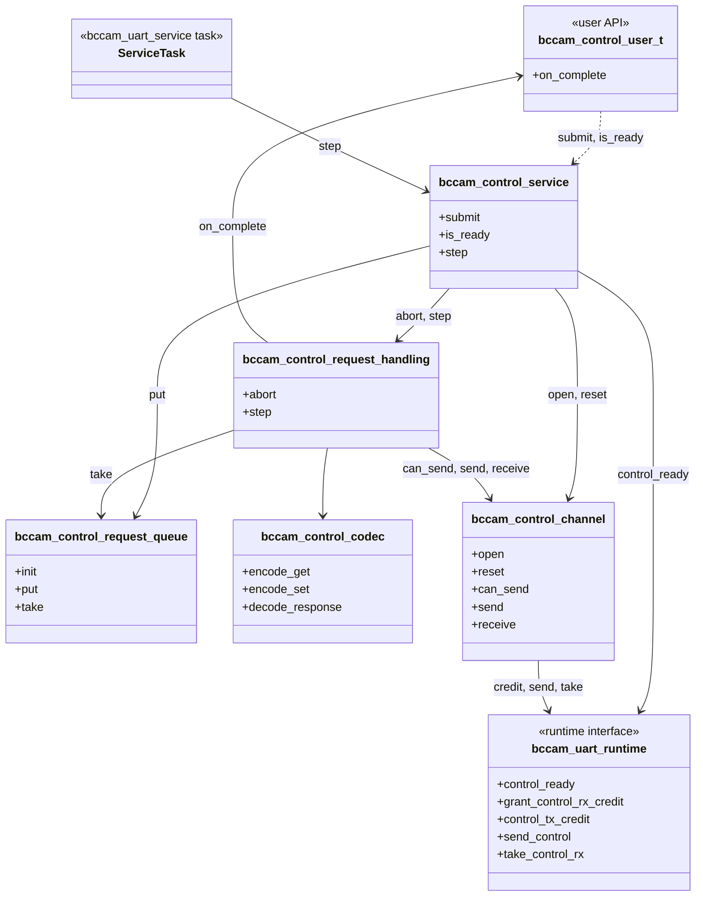
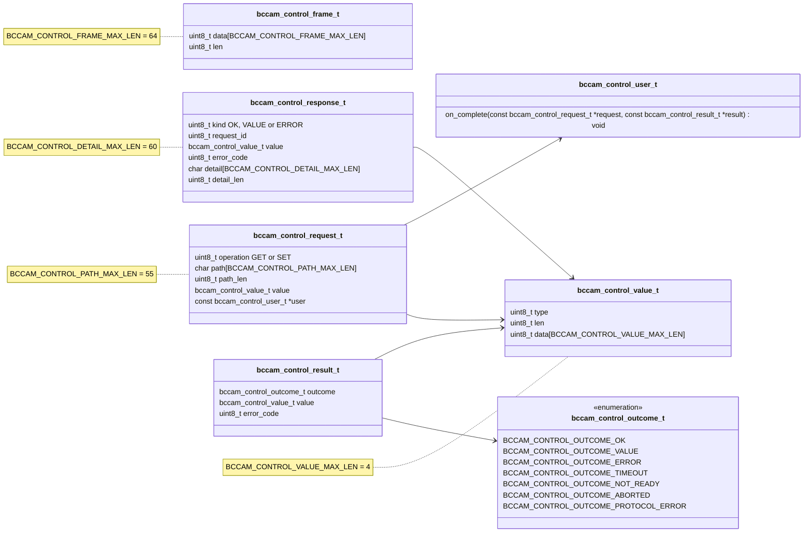
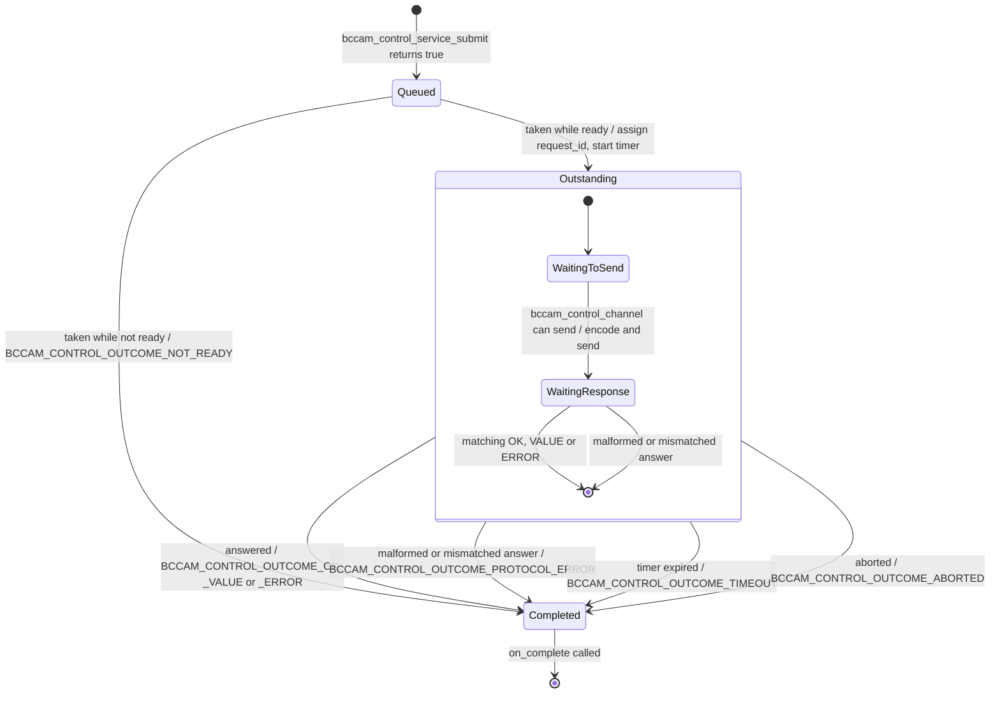
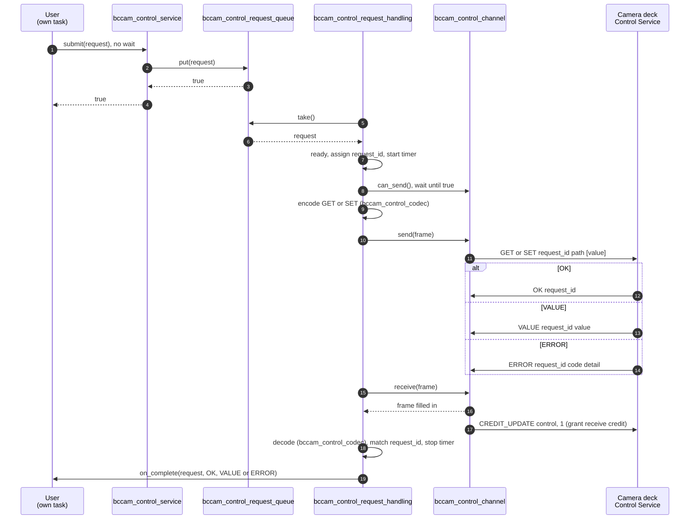
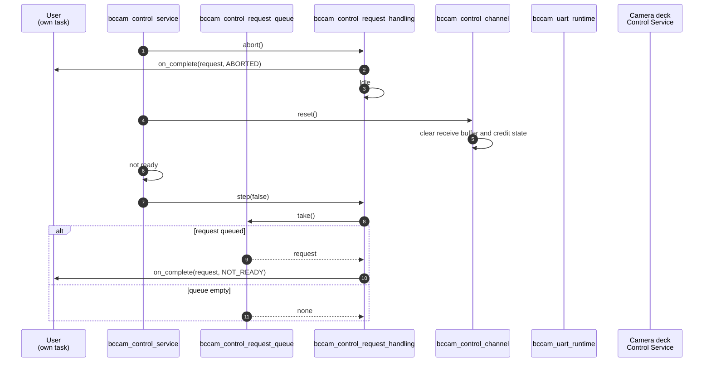
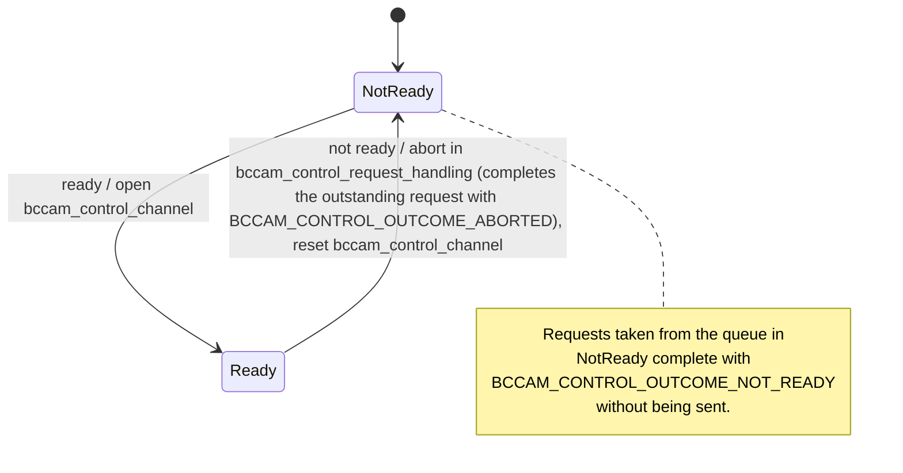
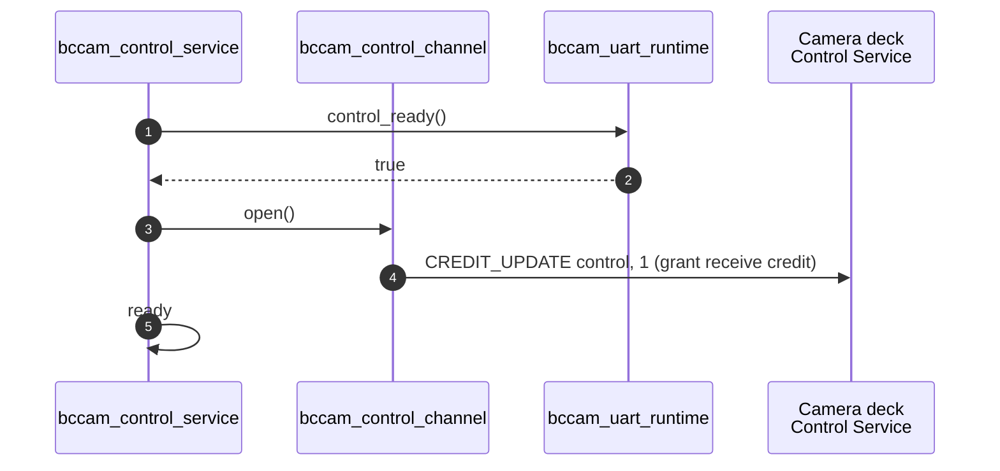
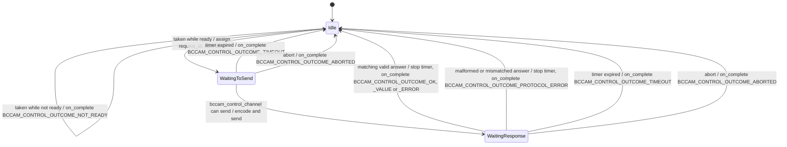
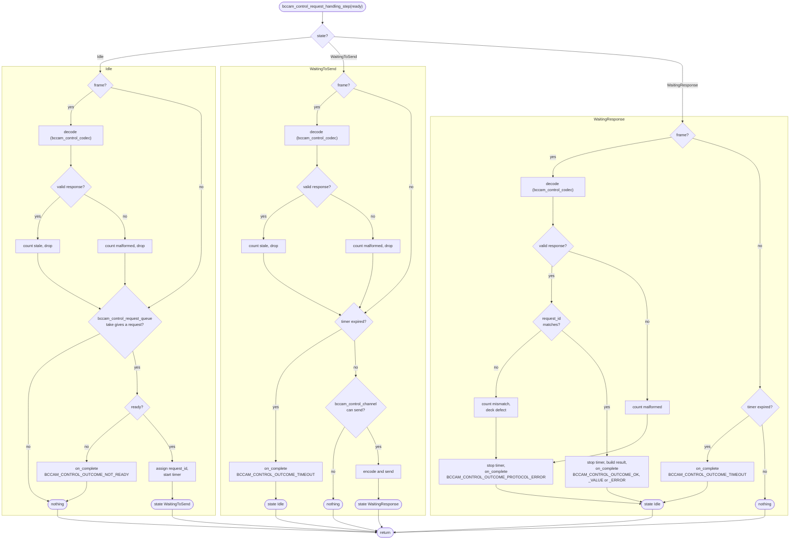
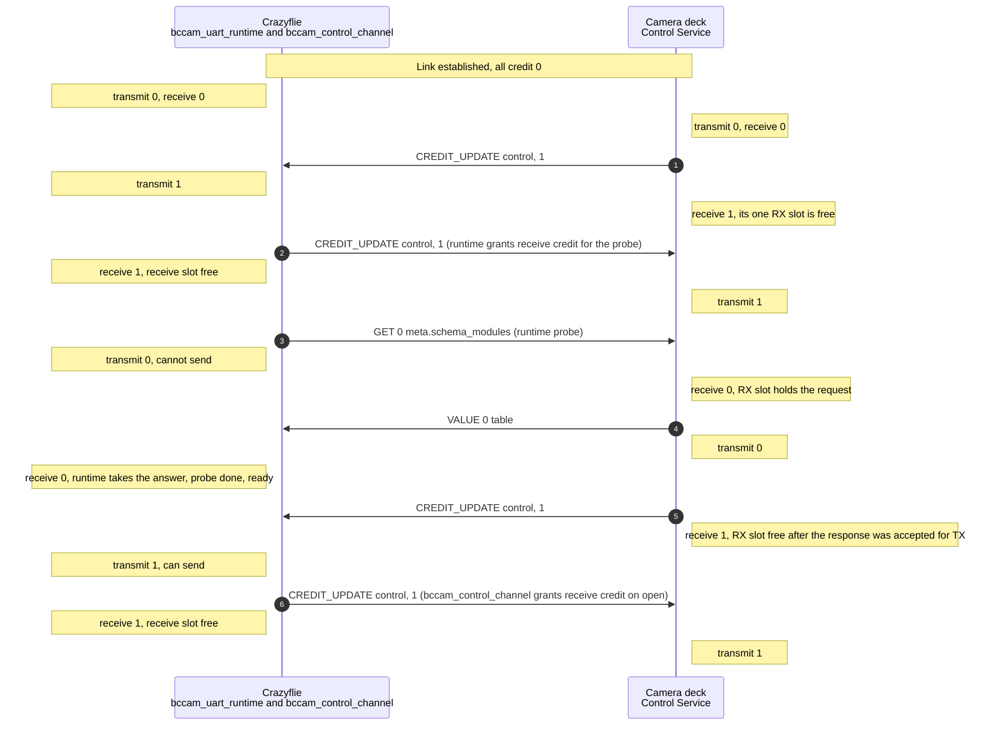

Design of the Control Service on the Crazyflie side of the UART link to the
camera deck.

The wire format is defined by the Control Service protocol in
camera-deck-firmware (`docs/protocol/common/control-service.md`). This page
summarizes the layout of the frames in scope, see [Frame layout](#frame-layout). Where they
differ, the protocol document is the authority.

## Scope

In scope, matching `bitcraze.control` version 0.0 on the deck:

- the requests `GET` and `SET`,
- the responses `OK`, `VALUE` and `ERROR`,
- the value types `bool`, `u8`, `i8`, `u16`, `i16`, `u32` and `i32`,
- one request outstanding at a time.

Out of scope: `CMD`, `NOTIFY`, more than one request in flight, path handles,
listing paths and chunking. The probe is also out of scope. The runtime runs
it before the Control Service takes over, see [Ready](#ready).

## Terms

The terms build on Frame-Slot Credit in the Common Link. Credit is per
service and per direction. Here they are used for the Control service, seen
from the Crazyflie.

- **Frame**: one Control message, the payload of one UART packet on the
  Control service. The runtime removes the UART packet envelope, so a frame
  starts with `kind`. A frame has no length field of its own. Its length is
  the UART packet's `payload_length`, at most the Link MTU. See "Frame
  layout".
- **Transmit credit**: Frame-Slot Credit the deck has given the Crazyflie.
  One credit allows the Crazyflie to send one Control frame.
- **Receive credit**: Frame-Slot Credit the Crazyflie has given the deck.
  One credit allows the deck to send one Control frame.
- **Receive slot**: local space for one received Control frame. Receive
  credit is never more than the number of free receive slots.
- **Grant receive credit**: the Crazyflie makes a free receive slot
  available to the deck. Freeing the slot and telling the deck always happen
  together.
- **Bound**: the Control service is bound when the catalog advertises a
  compatible `bitcraze.control` and the Crazyflie has taken its handle. This
  is Service Binding in the Common Link.
- **Ready**: the Control service is bound and the probe has been answered
  with `VALUE`. User requests are only transmitted while ready.
- **Probe**: the `GET 0 meta.schema_modules` request the runtime sends on
  the Control service before ready. The Control Service only observes the
  result.
- **Lifecycle**: the states of something that is created and ends, and goes
  through them once, such as a request from `bccam_control_service_submit`
  to `on_complete`.
- **State machine**: the states of something that lives as long as the
  system and moves between them repeatedly, such as
  `bccam_control_service`.
- **Unit**: one `.c` and `.h` pair with its own interface and its own host
  test. The Control Service layer consists of units.

### Frame layout

Every frame in scope starts with the same two bytes, followed by a body that
depends on `kind`:

| Byte | Field | Content |
|---|---|---|
| 0 | `kind` | `GET` 0x01, `SET` 0x02, `OK` 0x80, `VALUE` 0x81, `ERROR` 0x82. Bit 7 is set in frames from the deck. |
| 1 | `request_id` | Set by the Crazyflie in the request, copied by the deck into the answer. |
| 2.. | body | Depends on `kind`, see below. |

Bodies:

| `kind` | Body |
|---|---|
| `GET` | `path_len:u8`, `path` |
| `SET` | `path_len:u8`, `path`, `value` |
| `OK` | empty |
| `VALUE` | `value` |
| `ERROR` | `error_code:u8`, `detail_len:u8`, `detail` |

- `value` is `type:u8`, `len:u8`, `data[len]`. Multi-byte integers are
  little-endian.
- `path` is ASCII, `path_len` bytes, not NUL-terminated.
- A frame shorter than 2 bytes has no `request_id` and is malformed.
- `NOTIFY` (0xc0) is out of scope. It has no `request_id`: byte 1 is
  `path_len`.

## Layers

A layer is a level of the design with its own responsibility. It talks only
to the layer directly above and the layer directly below, through a defined
interface.

| Layer | Responsibility | Scope |
|---|---|---|
| Users, for example camera settings | Decide what to `GET` and `SET` | Out of scope. Only the API they call is defined. |
| Control Service | Turns user requests into Control frames and back. Handles readiness, timeouts and credit. | In scope |
| Runtime and Common Link | Bytes, frames, session, catalog, Service Binding, credit accounting and the probe | Out of scope. Only the interface the Control Service uses is defined. |

This page describes the Control Service layer and its two interfaces: the
user API above and the runtime interface below.

## Units

The Control Service is broken down into five units by responsibility.
`bccam_control_service` is above the other four and coordinates them.

| Unit | Responsibility |
|---|---|
| [`bccam_control_service`](#bccam_control_service) | The unit that holds all public functions of the control service. The single entry point the service task steps. Holds the ready flag. Tells the other units what to do in a fixed order. |
| [`bccam_control_request_queue`](#bccam_control_request_queue) | Hands submitted requests from user tasks to the service task. |
| [`bccam_control_request_handling`](#bccam_control_request_handling) | Handles one outstanding request. |
| [`bccam_control_codec`](#bccam_control_codec) | Library of functions for encoding, decoding and validation. |
| [`bccam_control_channel`](#bccam_control_channel) | Handles transmit and receive, and its allowance; the only unit aware of the receive slot and credit. |

`bccam_control_service` is stepped by the bcCam UART service task in
`bccam_uart_service`. All units run in that task. The exceptions are
`bccam_control_service_submit` and `bccam_control_service_is_ready`, which
users call from their own task, and `bccam_control_request_queue`, the only
unit shared between tasks.

The sections from [Structure](#structure) to [Error handling](#error-handling) cover more
than one unit. Each unit then has its own section.

## Structure

The units, the user API above them and the runtime interface below them.

The diagrams show functions by their name without the unit prefix: for example, `submit`
in `bccam_control_service` is `bccam_control_service_submit`. Functions are represented by
their names only. The signatures and fields are in [User API](#user-api), [Runtime interface](#runtime-interface) and each
unit's section.

The data passed through the user API, and the frame and response passed
between the units:

`bccam_control_frame_t` holds one frame, including its bytes. Assumption:
the Link Maximum Transmission Unit (MTU) is 64.

- `len` is the number of valid bytes in `data`, from 0 to
  `BCCAM_CONTROL_FRAME_MAX_LEN`. It replaces the UART packet's
  `payload_length`.
- `BCCAM_CONTROL_FRAME_MAX_LEN` is the Link MTU of the UART profile. `len`
  fits in a `uint8_t` because the MTU is at most 255.

The other types hold their data inline, sized so that every request and
response fits in one frame:

- `BCCAM_CONTROL_VALUE_MAX_LEN` is 4, the size of the largest value type in
  scope, `u32` and `i32`. `len` is the number of valid bytes in `data`.
- `BCCAM_CONTROL_PATH_MAX_LEN` is 55: a `SET` frame has 2 header bytes,
  `path_len`, the path and a value of at most 2 + 4 bytes. A request with a
  longer path cannot be built. `path` is ASCII, `path_len` bytes, not
  NUL-terminated.
- `BCCAM_CONTROL_DETAIL_MAX_LEN` is 60: an `ERROR` frame has 2 header bytes,
  `error_code` and `detail_len` before the detail. `detail` is UTF-8 text,
  `detail_len` bytes, not NUL-terminated.
- `bccam_control_response_t.value` is valid only when `kind` is `VALUE`,
  and `error_code` and `detail` only when `kind` is `ERROR`.
- `user` points to a static `bccam_control_user_t` that outlives every
  request. The path and value are copied, so the user can drop its request
  when `bccam_control_service_submit` returns.
- `bccam_control_user_t` holds one function pointer, `on_complete`. There
  is no context pointer: each user has its own `bccam_control_user_t` and
  its own callback, and `on_complete` gets the request, whose `user` tells
  which user it belongs to.

### User API

Users see only the user API: `bccam_control_service_submit` and
`bccam_control_service_is_ready`, see [bccam_control_service](#bccam_control_service), and their
own `on_complete` in their `bccam_control_user_t`.

| Function | What it does |
|---|---|
| `on_complete(const bccam_control_request_t *request, const bccam_control_result_t *result) void` | Tells the user that a request has completed, with its result. |

- `on_complete` is called in the service task. It must not block.
- Every submitted request gets exactly one `on_complete`.

### Runtime interface

The functions of the runtime that the Control Service uses. They belong to
`bccam_uart_runtime`. The runtime functions take the runtime instance,
`bccam_uart_runtime_t *runtime`, as their first argument. It is left out
here.

| Function | What it does |
|---|---|
| `bccam_uart_runtime_control_ready() bool` | Returns true when the Control service is bound and the runtime's probe has been answered with `VALUE`. Turns false when the binding is lost. |
| `bccam_uart_runtime_grant_control_rx_credit() void` | Grants one receive credit to the deck. Does not fail temporarily, see [Credit](#credit). |
| `bccam_uart_runtime_get_control_tx_credit() uint8_t` | Returns the transmit credit. |
| `bccam_uart_runtime_send_control(const bccam_control_frame_t *frame) void` | Sends a frame on the Control service, using one transmit credit. |
| `bccam_uart_runtime_take_control_rx(bccam_control_frame_t *frame) bool` | Copies a received frame out of the receive slot into `frame`. Returns true when a frame was taken. Returns false when the receive slot was empty, and `frame` must not be used. |

## Request lifecycle

The lifecycle of one request, from `bccam_control_service_submit` to
`on_complete`. One request is outstanding at a time. The timeout starts
when the request is taken from the queue, so it also covers waiting until a
frame can be sent.

### Sequence for request with an answer

A user submits a request and the deck answers it. Frames between
`bccam_control_channel` and the deck go through the runtime and the link.
This diagram describes the full lifecycle including all control service
units.

## Error handling

The cases in which a request does not get a matching answer, and what the
user gets.

| Case | Detected by | Handling | User gets |
|---|---|---|---|
| No answer before the timeout | `bccam_control_request_handling`, timer | Completes the request. Receive credit stays granted. | `BCCAM_CONTROL_OUTCOME_TIMEOUT` |
| Late answer to a request that timed out | `bccam_control_request_handling`, no request in WaitingResponse | Counts it as stale and drops it. | Nothing more, the request already got `BCCAM_CONTROL_OUTCOME_TIMEOUT` |
| Malformed answer in WaitingResponse | `bccam_control_codec` | Counts it as malformed and completes the request. The frame is the answer, so no other answer will follow. | `BCCAM_CONTROL_OUTCOME_PROTOCOL_ERROR` |
| `request_id` mismatch in WaitingResponse | `bccam_control_request_handling` | Counts it as a mismatch, a deck defect, and completes the request. The frame is the answer, so no other answer will follow. | `BCCAM_CONTROL_OUTCOME_PROTOCOL_ERROR` |
| Malformed frame in Idle or WaitingToSend | `bccam_control_codec` | Counts it as malformed and drops it. | Nothing more, the request already got `BCCAM_CONTROL_OUTCOME_TIMEOUT` |
| Ready lost with a request outstanding: deck reset, link fault or handle change | `bccam_control_service`, `bccam_uart_runtime_control_ready()` is false | Aborts in `bccam_control_request_handling`, then resets `bccam_control_channel`. | `BCCAM_CONTROL_OUTCOME_ABORTED` |
| Request taken from the queue while not ready | `bccam_control_request_handling`, stepped with ready false | Completes the request without sending it. | `BCCAM_CONTROL_OUTCOME_NOT_READY` |
| Queue full | `bccam_control_request_queue`, `bccam_control_request_queue_put` | `bccam_control_service_submit` returns false. | No `on_complete` |

A late answer can never complete the next request. `bccam_control_channel`
lets the next request be sent only when the deck has given transmit credit
again, and the deck does that only after its answer to the previous request
has been accepted for transmission. The link delivers frames in order, so
the late answer arrives before the next request is sent, while it is in
WaitingToSend. See [Credit](#credit) under [bccam_control_channel](#bccam_control_channel).

### Sequence for ready lost

A request is outstanding when the deck resets, the link faults or the
handle changes. `bccam_control_service`, in its step, finds that the
runtime reports `bccam_uart_runtime_control_ready()` as false. It aborts in
`bccam_control_request_handling`, resets `bccam_control_channel` and goes
to not ready, in the order in [bccam_control_service](#bccam_control_service).
A request taken from the queue after that completes with
`BCCAM_CONTROL_OUTCOME_NOT_READY`.

## bccam_control_service

The unit above the other four. It is the only unit users see, through
`bccam_control_service_submit` and `bccam_control_service_is_ready`, and the
single entry point the service task steps. `bccam_control_service_submit`
passes the request on to `bccam_control_request_queue` and does not block.
The Control Service is ready when the runtime reports
`bccam_uart_runtime_control_ready()`: the Control service is bound and the
runtime's probe has been answered. User requests are only sent while it is
ready. `bccam_control_service` observes ready and not ready and tells the
other units what to do, in a fixed order on each. The other units do not
know about ready and not ready. `bccam_control_request_handling` gets the
ready flag as an argument to its step.

- Order on ready: `bccam_control_service` opens `bccam_control_channel`
  with `bccam_control_channel_open`, which grants receive credit, then
  sets the ready flag.
- Order on not ready: `bccam_control_service` tells
  `bccam_control_request_handling` to abort with
  `bccam_control_request_handling_abort`, which completes the outstanding
  request with `BCCAM_CONTROL_OUTCOME_ABORTED`, then resets
  `bccam_control_channel` with `bccam_control_channel_reset`, and goes to
  not ready. Requests taken from the queue after that complete with
  `BCCAM_CONTROL_OUTCOME_NOT_READY`.
- The ready flag is written only in the service task. Users read it with
  `bccam_control_service_is_ready` from their own task.

### Functions

| Function | What it does |
|---|---|
| `bccam_control_service_submit(const bccam_control_request_t *request) bool` | Passes the request on to `bccam_control_request_queue` with `bccam_control_request_queue_put`, without blocking. Returns false when the queue is full, and the request is not queued. |
| `bccam_control_service_is_ready() bool` | Returns the ready flag. |
| `bccam_control_service_step() void` | Observes `bccam_uart_runtime_control_ready()`, acts on ready and not ready in the order above, and steps `bccam_control_request_handling` with the ready flag. |

### Data

| Field | Type | What it holds |
|---|---|---|
| `ready` | `bool` | The ready flag. Written only in the service task. |

### State machine

### Ready

The runtime establishes the link, enumerates the catalog and runs the
probe. The flow starts when `bccam_control_service`, in its step, finds
that the runtime reports `bccam_uart_runtime_control_ready()` as true. It
opens `bccam_control_channel` and sets the ready flag, which users read with
`bccam_control_service_is_ready`. Users can then submit requests as in [Request with an answer](#sequence-for-request-with-an-answer). Frames between
`bccam_control_channel` and the deck go through the runtime and the link.

## bccam_control_request_queue

Hands submitted requests from user tasks to the service task.
`bccam_control_request_queue_put` is called from user tasks, through
`bccam_control_service`. `bccam_control_request_queue_take` is called from
the service task, by `bccam_control_request_handling`.

### Storage

- The requests are stored in a FreeRTOS queue in static memory, the same
  pattern as the request queue in `bccam_uart_service`.
- The queue holds 4 requests.
- Each entry is a copy of the whole `bccam_control_request_t`, including
  its `value`. The user can reuse or drop its request as soon as
  `bccam_control_service_submit` returns.
- `bccam_control_request_queue_take` copies the request out to
  `bccam_control_request_handling`, which keeps it while the request is
  outstanding. The `request` passed to `on_complete` is that copy, not the
  user's original.
- The FreeRTOS queue makes `bccam_control_request_queue_put` and
  `bccam_control_request_queue_take` safe between tasks.
  `bccam_control_request_queue` has no lock of its own.
- The service task is not notified when a request is put. It finds the
  request the next time it polls the queue, within its idle wait.
- The queue is not cleared when ready is lost.

### Functions

| Function | What it does |
|---|---|
| `bccam_control_request_queue_init() void` | Creates the queue. |
| `bccam_control_request_queue_put(const bccam_control_request_t *request) bool` | Copies the request into the queue without blocking. Returns false when the queue is full, and the request is not queued. |
| `bccam_control_request_queue_take(bccam_control_request_t *request) bool` | Copies the oldest request out of the queue without blocking. Returns false when the queue is empty. |

Requests are taken in the order they were put.

## bccam_control_request_handling

The unit `bccam_control_request_handling` is the main responsible unit for
the request lifecycle: taking requests off the queue, sending, receiving
the answer and calling the `on_complete` function.

The unit is stepped by `bccam_control_service`, once per service step.

Handles one outstanding request at a time. It sends requests only while
ready. It calls `bccam_control_codec` to encode requests and to decode and
validate answers.

- `request_id` is incremented for each request and wraps at 255. In
  WaitingResponse it is a check: a mismatch means a deck defect, not a
  late answer. Starts at 1 (since one request is needed to make the 
  control service ready, part of runtime).

### Functions

| Function | What it does |
|---|---|
| `bccam_control_request_handling_abort() void` | Completes the outstanding request with `BCCAM_CONTROL_OUTCOME_ABORTED` and goes to Idle. Does nothing in Idle. |
| `bccam_control_request_handling_step(bool ready) void` | Does one step, see [One step](#one-step). |

### Data

| Field | Type | What it holds |
|---|---|---|
| `outstanding` | `bccam_control_request_t` | The copy of the outstanding request, taken from `bccam_control_request_queue`. Passed to `on_complete`. |
| `next_request_id` | `uint8_t` | The `request_id` for the next request. Starts at 1 and wraps at 255. |
| `deadline` | Not decided | When the outstanding request times out. |

### State machine

### One step

What `bccam_control_request_handling` does in one call to
`bccam_control_request_handling_step(ready)`, from start to return. Each
state has its own swim lane. Each lane starts by decoding a received frame
with `bccam_control_codec` - the receive mechanism depends on that all
received frames are handled, even the unwanted ones. A lane ends either
without changing the state or by setting a new state, which takes effect
from the next step. `bccam_control_channel` has already granted receive
credit for a received frame, so no branch has to.

Assumptions:

- `bccam_control_channel` grants one receive credit at a time.
- `bccam_control_channel` lets a request be sent only after any answer to
  the previous request has been delivered, see [Request lifecycle](#request-lifecycle).
- The deck sends exactly one answer per request.
- Every frame from the deck is an answer. This no longer holds if `NOTIFY`
  is brought into scope.

Consequences and design choices:

- At most one frame is received per step, since there is never more than
  one frame to take.
- Receiving comes before the timeout check, so an answer that arrives in
  the same step as the deadline completes the request.
- In WaitingResponse, any received frame is the answer to the outstanding
  request. A malformed answer or a `request_id` mismatch therefore
  completes the request at once with `BCCAM_CONTROL_OUTCOME_PROTOCOL_ERROR`
  instead of waiting for the timeout, since no other answer will follow.
- `bccam_control_codec` treats `NOTIFY` as malformed. If `NOTIFY` is
  brought into scope, a `NOTIFY` in WaitingResponse would wrongly complete
  the request with `BCCAM_CONTROL_OUTCOME_PROTOCOL_ERROR`. `NOTIFY` must
  then be told apart from a malformed answer and not complete the request.
- At most one request is taken from the queue per step, also when it
  completes with `BCCAM_CONTROL_OUTCOME_NOT_READY`.
- A request moves at most one state per step. A request taken in one step
  is sent at the earliest in the next step, and the next request is taken
  at the earliest in the step after the previous one completed.

## bccam_control_codec

Encodes `GET` and `SET`, and decodes `OK`, `VALUE` and `ERROR` and
validates their bodies. Pure functions without state. 

### Functions

| Function | What it does |
|---|---|
| `bccam_control_codec_encode_get(uint8_t request_id, const char *path, uint8_t path_len) bccam_control_frame_t` | Builds a `GET` frame as in [Frame layout](#frame-layout). |
| `bccam_control_codec_encode_set(uint8_t request_id, const char *path, uint8_t path_len, const bccam_control_value_t *value) bccam_control_frame_t` | Builds a `SET` frame as in [Frame layout](#frame-layout). |
| `bccam_control_codec_decode_response(const bccam_control_frame_t *frame, bccam_control_response_t *response) bool` | Validates the frame. Returns true and fills in `response` when the frame is valid. Returns false when it is malformed, and `response` must not be used. |

A valid `response` holds `kind`, `request_id` and the body. A
frame is malformed when:

- it is shorter than 2 bytes,
- `kind` is not `OK`, `VALUE` or `ERROR`, which includes `NOTIFY`,
- the body does not match [Frame layout](#frame-layout) for the `kind`, or bytes remain
  after it.

## bccam_control_channel

The only unit aware of the receive slot and credit. It works with raw
frames only and does not know the Control message format.

- On `bccam_control_channel_open`, it grants the first receive credit. The
  runtime's probe leaves receive credit at 0 when it is done.
- On `bccam_control_channel_reset`, it clears the receive buffer and its
  credit state.
- It tells whether a frame can be sent, which hides the transmit credit.
- On receive, it copies the frame out of the receive slot into the caller's
  `bccam_control_frame_t` and grants receive credit at once.
- It guarantees that a frame can be sent only after any answer to the
  previous request has been delivered. `bccam_control_request_handling`
  relies on this to recognize stale answers.

### Functions

| Function | What it does |
|---|---|
| `bccam_control_channel_open() void` | Grants the first receive credit. |
| `bccam_control_channel_reset() void` | Clears the receive buffer and the credit state. |
| `bccam_control_channel_can_send() bool` | Returns true when a frame can be sent, that is when there is transmit credit. |
| `bccam_control_channel_send(const bccam_control_frame_t *frame) void` | Sends the raw frame. |
| `bccam_control_channel_receive(bccam_control_frame_t *frame) bool` | Copies a received frame out of the receive slot into `frame` and grants receive credit at once. Returns true when a frame was received. Returns false when there was none, and `frame` must not be used. |

### Data

| Field | Type | What it holds |
|---|---|---|
| `rx_buffer` | `bccam_control_frame_t` | The receive buffer. Cleared on `bccam_control_channel_reset`. |

### Credit

How the Control service's transmit credit and receive credit change from
link establishment, through the runtime's probe, until
`bccam_control_channel` is opened and both sides have credit again. This is
why `bccam_control_channel` can guarantee that a frame can be sent only
after any answer to the previous request has been delivered, also for the
first request after the probe.

There is no negotiation. Each receiver grants credit for its free receive
slots with `CREDIT_UPDATE`, and each sender uses one credit per frame. The
deck has one Control RX slot and grants credit again only after its response
has been accepted for transmission. The link delivers frames in order, so
transmit credit 1 means that the deck is ready for the next request and that
its answer to the previous one has already arrived.

- Steps 1 and 2 can come in either order, and so can steps 5 and 6.
- The runtime does not grant receive credit again after the probe answer.
  `bccam_control_channel` grants it on `bccam_control_channel_open`, after
  `bccam_control_service` has seen ready.
- After a timeout, the receive credit stays granted. Either the late answer
  uses it, and receive credit is granted again when it is received, or the
  next request finds it already granted.
- `bccam_uart_runtime_grant_control_rx_credit` does not fail temporarily.
  When the grant cannot be sent at once, the runtime keeps it pending and
  sends it on a later step. A request sent while a grant is pending waits
  for its answer until the grant is sent, within its timeout.

## Open questions

Does this design support the full chain control service, from deck to cflib? Because it is created with the temporary param path in mind.

TODO: Add public functions to all units
