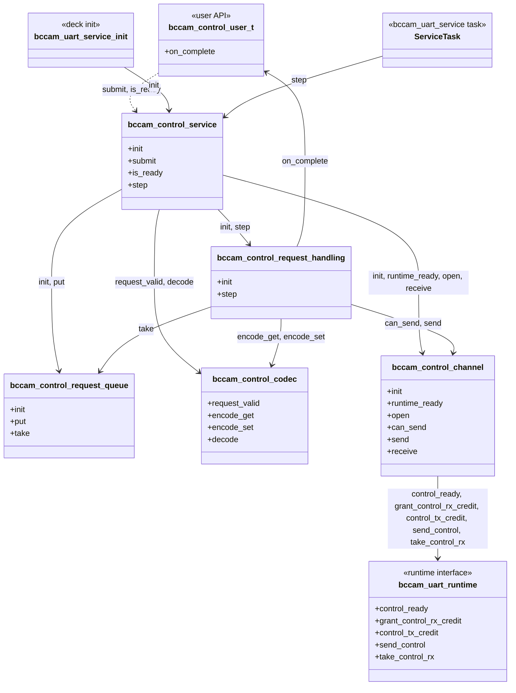
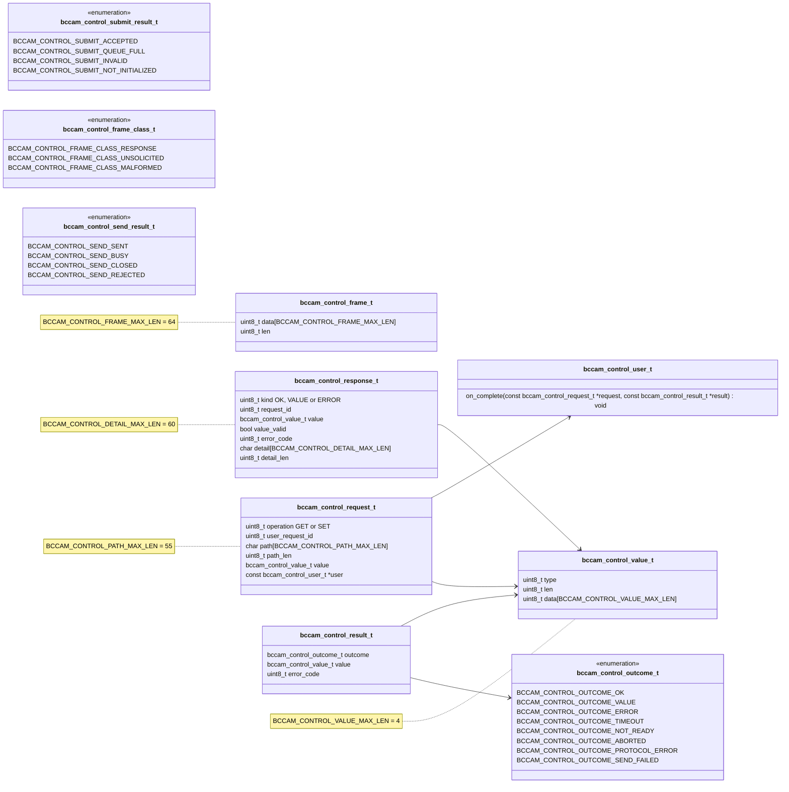
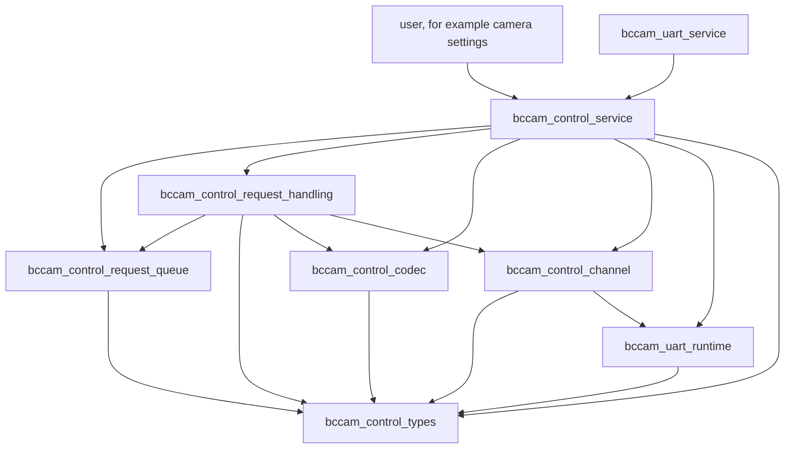
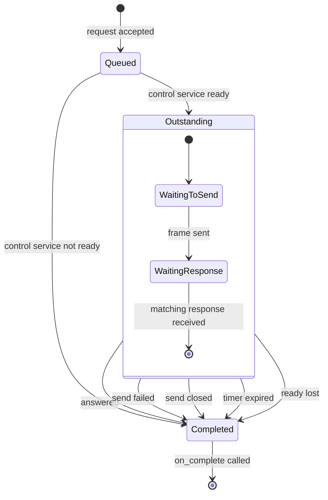
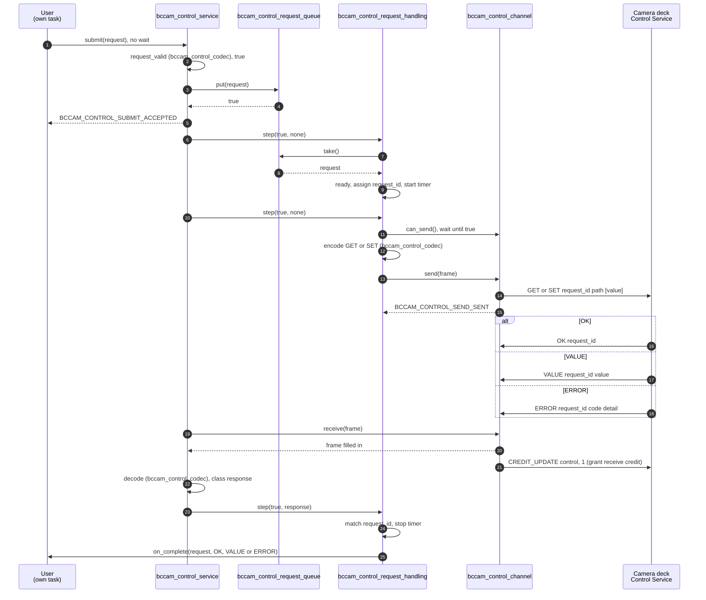
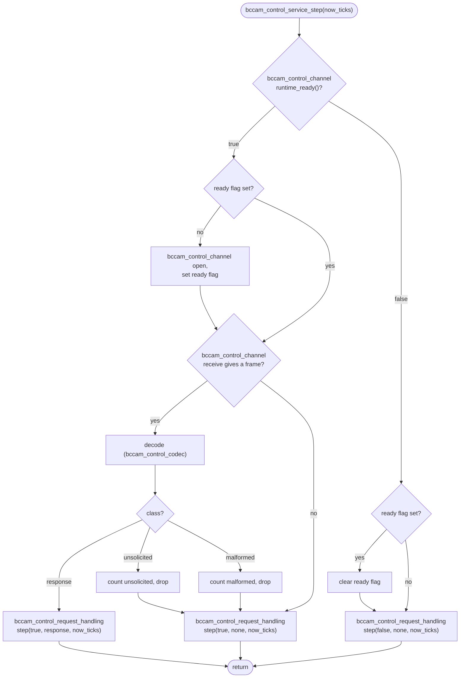
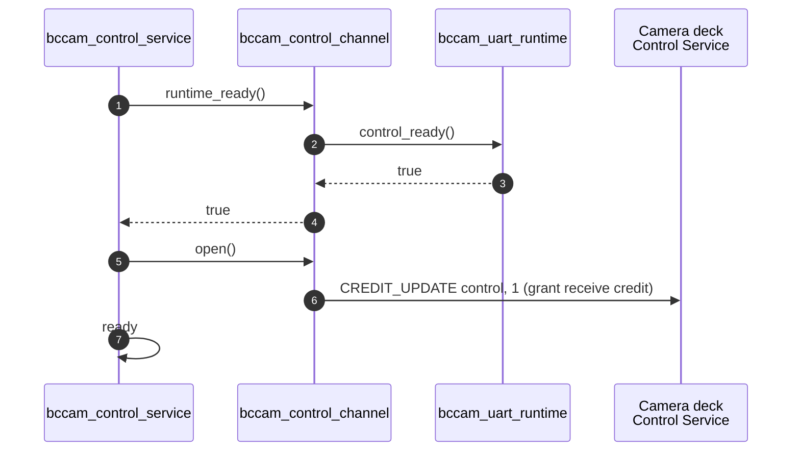
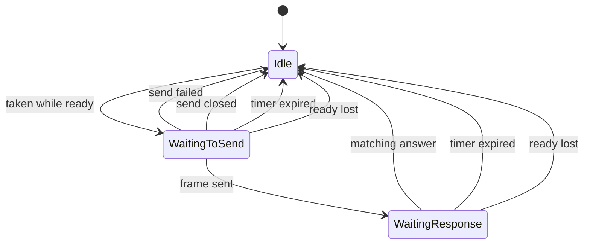
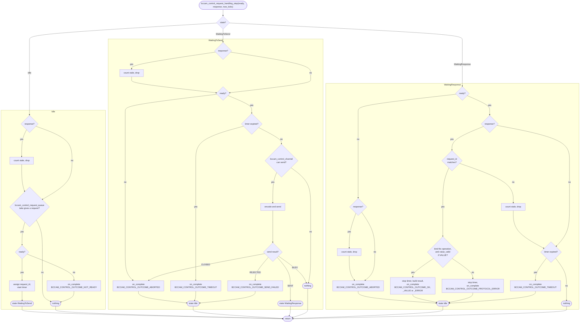
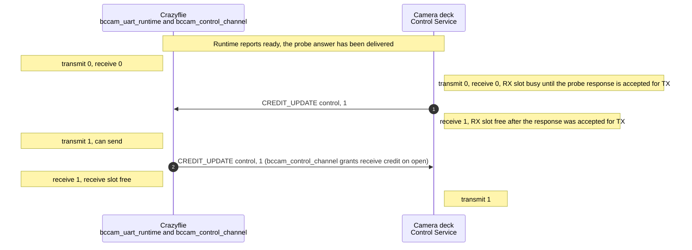

Design of the Control Service on the Crazyflie side of the UART link to the
camera deck.

The wire format is defined by the Control Service protocol in
camera-deck-firmware (`docs/protocol/common/control-service.md`). This page
summarizes the layout of the frames in scope, see [Frame layout](#frame-layout). Where they
differ, the protocol document is the authority.

## Scope

In scope, matching `bitcraze.control` version 0.0 on the deck:

- the requests `GET` and `SET`,
- the responses `OK`, `VALUE` and `ERROR`,
- the value types `bool`, `u8`, `i8`, `u16`, `i16`, `u32` and `i32`,
- one request outstanding at a time,
- recognizing unsolicited frames from the deck, such as `NOTIFY`, and
  dropping them, see [Frame classes](#frame-classes).

Out of scope: `CMD`, handling `NOTIFY`, more than one request in flight,
path handles, listing paths and chunking. The probe is also out of scope.
The runtime runs it before the Control Service takes over, see
[Ready](#ready).

## Terms

The terms build on Frame-Slot Credit in the Common Link. Credit is per
service and per direction. Here they are used for the Control service, seen
from the Crazyflie.

- **Frame**: one Control message, the payload of one UART packet on the
  Control service. The runtime removes the UART packet envelope, so a frame
  starts with `kind`. A frame has no length field of its own. Its length is
  the UART packet's `payload_length`, at most the Link MTU. See "Frame
  layout".
- **Transmit credit**: Frame-Slot Credit the deck has given the Crazyflie.
  One credit allows the Crazyflie to send one Control frame.
- **Receive credit**: Frame-Slot Credit the Crazyflie has given the deck.
  One credit allows the deck to send one Control frame.
- **Receive slot**: local space for one received Control frame. Receive
  credit is never more than the number of free receive slots.
- **Grant receive credit**: the Crazyflie makes a free receive slot
  available to the deck. Freeing the slot and telling the deck always happen
  together.
- **Bound**: the Control service is bound when the catalog advertises a
  compatible `bitcraze.control` and the Crazyflie has taken its handle. This
  is Service Binding in the Common Link.
- **Ready**: the Control service is bound and the probe has been answered
  with `VALUE`. User requests are only transmitted while ready.
- **Deck request ID**: the `request_id` on the wire between the Crazyflie
  and the deck. Owned by the Control Service, which assigns it. Users never
  see it.
- **User request ID**: the request ID between a user and the Crazyflie.
  Owned by the user, which assigns it. The Control Service does not read it
  and returns it with the result. For example, a user submits user request
  ID 2, the Control Service sends it to the deck as deck request ID 8, the
  deck answers 8, and the user gets `on_complete` for user request ID 2.
- **Probe**: the `GET 0 meta.schema_modules` request the runtime sends on
  the Control service before ready. The Control Service only observes the
  result.
- **Lifecycle**: the states of something that is created and ends, and goes
  through them once, such as a request from `bccam_control_service_submit`
  to `on_complete`.
- **State machine**: the states of something that lives as long as the
  system and moves between them repeatedly, such as
  `bccam_control_service`.
- **Unit**: one `.c` and `.h` pair with its own interface and its own host
  test. The Control Service layer consists of units.

### Frame layout

Every frame in scope starts with the same two bytes, followed by a body that
depends on `kind`:

| Byte | Field | Content |
|---|---|---|
| 0 | `kind` | `GET` 0x01, `SET` 0x02, `OK` 0x80, `VALUE` 0x81, `ERROR` 0x82. Bit 7 is set in frames from the deck. |
| 1 | `request_id` | The deck request ID. Set by the Crazyflie in the request, copied by the deck into the answer. |
| 2.. | body | Depends on `kind`, see below. |

Bodies:

| `kind` | Body |
|---|---|
| `GET` | `path_len:u8`, `path` |
| `SET` | `path_len:u8`, `path`, `value` |
| `OK` | empty |
| `VALUE` | `value` |
| `ERROR` | `error_code:u8`, `detail_len:u8`, `detail` |

- `value` is `type:u8`, `len:u8`, `data[len]`. Multi-byte integers are
  little-endian.
- The value types in scope and their type codes: `bool` 0x01, `u8` 0x10,
  `i8` 0x11, `u16` 0x12, `i16` 0x13, `u32` 0x14 and `i32` 0x15.
- `path` is ASCII, `path_len` bytes, not NUL-terminated.
- A response shorter than 2 bytes has no `request_id` and is malformed.

### Frame classes

`bccam_control_codec` sorts every received frame into one of three classes
by its `kind`, using the ranges of the message-kind allocation in the
protocol:

| Class | `kind` |
|---|---|
| Response | `OK`, `VALUE` or `ERROR` (in 0x80..0xbf), with a body that matches [Frame layout](#frame-layout)
| Unsolicited | 0xc0..0xff, for example `NOTIFY`. |
| Malformed | Everything else |

## Layers

A layer is a level of the design with its own responsibility. It talks only
to the layer directly above and the layer directly below, through a defined
interface.

| Layer | Responsibility | Scope |
|---|---|---|
| Users, for example camera settings | Decide what to `GET` and `SET` | Out of scope. Only the API they call is defined. |
| Control Service | Turns user requests into Control frames and back. Handles readiness, timeouts and credit. | In scope |
| Runtime and Common Link | Bytes, frames, session, catalog, Service Binding, credit accounting and the probe | Out of scope. Only the interface the Control Service uses is defined. |

This page describes the Control Service layer and its two interfaces: the
user API above and the runtime interface below.

Note that the service task (`bcCamUartTask` in `bccam_uart_service`), which
is part of the runtime layer, steps the Control Service.
`bccam_control_service_init` is called from `bccam_uart_service_init`,
before the service task is created. `bccam_control_service_step` must be
called only from the service task. The service task steps the Control
Service once per loop iteration, in every service state.

## Units

The Control Service is broken down into five units by responsibility.
`bccam_control_service` is above the other four and coordinates them.

| Unit | Responsibility |
|---|---|
| [`bccam_control_service`](#bccam_control_service) | The unit that holds all public functions of the control service. The single entry point the service task steps. Holds the ready flag. Tells the other units what to do in a fixed order. Receives frames and passes responses on to `bccam_control_request_handling`. |
| [`bccam_control_request_queue`](#bccam_control_request_queue) | Hands submitted requests from user tasks to the service task. |
| [`bccam_control_request_handling`](#bccam_control_request_handling) | Handles one outstanding request. |
| [`bccam_control_codec`](#bccam_control_codec) | Library of functions for encoding, decoding and validation. |
| [`bccam_control_channel`](#bccam_control_channel) | Handles transmit and receive, and its allowance; the only unit aware of the receive slot and credit. The only unit that calls the runtime. |

The sections from [Structure](#structure) to [Error handling](#error-handling) cover more
than one unit. Each unit then has its own section.

## Structure

The units, the user API above them and the runtime interface below them.

The diagrams show functions by their name without the unit prefix: for example, `submit`
in `bccam_control_service` is `bccam_control_service_submit`. Functions are represented by
their names only. The signatures and fields are in [User API](#user-api), [Runtime interface](#runtime-interface) and each
unit's section.

The data passed through the user API, and the frame and response passed
between the units:

`bccam_control_frame_t` holds one frame, including its bytes. Assumption:
the Link Maximum Transmission Unit (MTU) is 64.

- `len` is the number of valid bytes in `data`, from 0 to
  `BCCAM_CONTROL_FRAME_MAX_LEN`. It replaces the UART packet's
  `payload_length`.
- `BCCAM_CONTROL_FRAME_MAX_LEN` is the Link MTU of the UART profile. `len`
  fits in a `uint8_t` because the MTU is at most 255.

The other types hold their data inline, sized so that every request and
response fits in one frame:

- `BCCAM_CONTROL_VALUE_MAX_LEN` is 4, the size of the largest value type in
  scope, `u32` and `i32`. `len` is the number of valid bytes in `data`.
- `BCCAM_CONTROL_PATH_MAX_LEN` is 55: a `SET` frame has 2 header bytes,
  `path_len`, the path and a value of at most 2 + 4 bytes. A request with a
  longer path cannot be built. `path` is ASCII, `path_len` bytes, not
  NUL-terminated.
- `BCCAM_CONTROL_DETAIL_MAX_LEN` is 60: an `ERROR` frame has 2 header bytes,
  `error_code` and `detail_len` before the detail. `detail` is UTF-8 text,
  `detail_len` bytes, not NUL-terminated.
- `bccam_control_response_t.value` and `value_valid` are valid only when
  `kind` is `VALUE`, and `error_code` and `detail` only when `kind` is
  `ERROR`. `value_valid` is false when the value fails the value checks in
  [bccam_control_codec](#bccam_control_codec). `value` must then not be
  used.
- `bccam_control_frame_class_t` is the class of a received frame, see
  [Frame classes](#frame-classes).
- `bccam_control_submit_result_t` is what `bccam_control_service_submit`
  returns, see [bccam_control_service](#bccam_control_service).
- `user` points to a static `bccam_control_user_t` that outlives every
  request. The path and value are copied, so the user can drop its request
  when `bccam_control_service_submit` returns.
- `bccam_control_user_t` holds one function pointer, `on_complete`. There
  is no context pointer: each user has its own `bccam_control_user_t` and
  its own callback, and `on_complete` gets the request, whose `user` tells
  which user it belongs to.
- `user_request_id` is the user request ID. The user sets it in
  `bccam_control_request_t`, and the Control Service does not read it. It
  reaches `on_complete` in the request copy, so `bccam_control_result_t`
  does not repeat it. It is not the deck request ID, which only
  `bccam_control_request_handling` knows.
- `operation` holds the wire `kind` from the protocol, `GET` 0x01 or `SET`
  0x02, see [Frame layout](#frame-layout). In the same way,
  `bccam_control_response_t.kind` holds `OK` 0x80, `VALUE` 0x81 or `ERROR`
  0x82. The constants are defined in `bccam_control_types.h`.

Which units include which. An arrow from one unit to another means that
the first unit includes the header of the other. All the types above are in
`bccam_control_types.h`, a header with no `.c` file. Standard headers such
as `stdbool.h` and `stdint.h` are left out.

- `bccam_control_service` and `bccam_control_channel` include
  `bccam_uart_runtime` for `bccam_uart_runtime_t`, which their init
  functions take.
- `bccam_uart_runtime` includes `bccam_control_types` for
  `bccam_control_frame_t`, which `bccam_uart_runtime_send_control` and
  `bccam_uart_runtime_take_control_rx` take, see
  [Runtime interface](#runtime-interface).
- Users and `bccam_uart_service` include only `bccam_control_service`.
- There are no include cycles. `bccam_control_types` includes no other
  project header.

### User API

Users see only the user API: `bccam_control_service_submit` and
`bccam_control_service_is_ready`, see [bccam_control_service](#bccam_control_service), and their
own `on_complete` in their `bccam_control_user_t`.

| Function | What it does |
|---|---|
| `on_complete(const bccam_control_request_t *request, const bccam_control_result_t *result) void` | Tells the user that a request has completed, with its result. |

- `on_complete` is called in the service task. It must not block.
- Every request for which `bccam_control_service_submit` returns
  `BCCAM_CONTROL_SUBMIT_ACCEPTED` gets exactly one `on_complete`. A request
  for which it returns `BCCAM_CONTROL_SUBMIT_QUEUE_FULL`,
  `BCCAM_CONTROL_SUBMIT_INVALID` or `BCCAM_CONTROL_SUBMIT_NOT_INITIALIZED`
  gets none. `_QUEUE_FULL` may be retried later. `_INVALID` is a bug in the
  user and must not be retried unchanged. `_NOT_INITIALIZED` means that
  `bccam_control_service_init` has not been called, for example because no
  camera deck is attached. A retry does not help until it has been called.
- `on_complete` gets the copy of the whole request, including its user
  request ID, for every outcome. This includes the outcomes the Crazyflie
  produces itself: `BCCAM_CONTROL_OUTCOME_NOT_READY`, `_ABORTED`,
  `_TIMEOUT`, `_PROTOCOL_ERROR` and `_SEND_FAILED`. A user that needs only
  the user request ID, such as a future cflib proxy, can ignore the rest. A user that needs
  the operation, path or value, such as the param adapter, does not have
  to keep its own table of pending requests.
  `bccam_control_request_handling` holds the copy while the request is
  outstanding anyway.
- User request IDs are separate per user. Two users can use the same user
  request ID. The Control Service does not check them for uniqueness.
- A user should not reuse a user request ID while a request with it is queued
  or outstanding.
- The Control Service does not check that the type of a `VALUE` is the
  type the user expects for the path. The deck is the authority on the
  type of a path. A user that expects a type checks it itself. The param
  adapter, for example, compares it with the type of the param. For `SET`,
  the deck checks the type and answers `ERROR` when it does not match,
  which gives `BCCAM_CONTROL_OUTCOME_ERROR`.

### Runtime interface

The functions of the runtime that the Control Service uses. They belong to
`bccam_uart_runtime`. Only `bccam_control_channel` calls them. The runtime
functions take the runtime instance, `bccam_uart_runtime_t *runtime`, as
their first argument. It is left out here. The runtime instance is
`firmware_client.runtime`, held by the `bccam_firmware_uart_client_t`
`firmware_client` in `bccam_uart_service`. `bccam_uart_service` passes it
to `bccam_control_service_init`, which
passes it on to `bccam_control_channel_init`. `bccam_control_channel`
stores it.

| Function | What it does |
|---|---|
| `bccam_uart_runtime_control_ready() bool` | Returns true when the Control service is bound and the runtime's probe has been answered with `VALUE`. Turns false when the binding is lost. |
| `bccam_uart_runtime_grant_control_rx_credit() void` | Grants one receive credit to the deck. Does not fail temporarily, see [Credit](#credit). |
| `bccam_uart_runtime_control_tx_credit() uint8_t` | Returns the transmit credit. Returns 0 when the Control service is not bound. |
| `bccam_uart_runtime_send_control(const bccam_control_frame_t *frame) int` | Sends a frame on the Control service, using one transmit credit. Returns the result of `bccam_uart_link_send_normal`, a `bccam_uart_result_t` value: `BCCAM_UART_OK` when the frame was queued, otherwise a `BCCAM_UART_ERR_*` code and no credit is used. |
| `bccam_uart_runtime_take_control_rx(bccam_control_frame_t *frame) bool` | Copies a received frame out of the receive slot into `frame`. Returns true when a frame was taken. Returns false when the receive slot was empty, and `frame` must not be used. |

## Request lifecycle

The lifecycle of one request, from `bccam_control_service_submit` to
`on_complete`. One request is outstanding at a time. The timeout starts
when the request is taken from the queue, so it also covers waiting until a
frame can be sent.

### Sequence for request with an answer

A user submits a request and the deck answers it. Frames between
`bccam_control_channel` and the deck go through the runtime and the link.
This diagram describes the full lifecycle including all control service
units.

## bccam_control_service

The unit above the other four. It is the only unit users see, through
`bccam_control_service_submit` and `bccam_control_service_is_ready`, and the
single entry point the service task steps. `bccam_control_service_submit`
validates the request and passes it on to `bccam_control_request_queue`. It
does not block.
The Control Service is ready when the runtime reports
`bccam_uart_runtime_control_ready()`: the Control service is bound and the
runtime's probe has been answered. `bccam_control_service` reads it through
`bccam_control_channel_runtime_ready()`. User requests are only sent while
it is ready. `bccam_control_service` observes ready and not ready and tells
the other units what to do, in a fixed order on each. The other units do
not act on ready and not ready themselves. `bccam_control_channel` only
reports it. `bccam_control_request_handling`
gets the ready flag as an argument to its step.

- Order on ready: `bccam_control_service` opens `bccam_control_channel`
  with `bccam_control_channel_open`, which grants receive credit, then
  sets the ready flag.
- Order on not ready: `bccam_control_service` goes to not ready, then
  steps `bccam_control_request_handling` with ready false,
  which completes the outstanding request with
  `BCCAM_CONTROL_OUTCOME_ABORTED`. Requests taken from the queue after that
  complete with `BCCAM_CONTROL_OUTCOME_NOT_READY`.
- The ready flag is written only in the service task. Users read it with
  `bccam_control_service_is_ready` from their own task.

`bccam_control_service` also receives the frames from the deck, so that
`bccam_control_request_handling` sees only responses:

- It receives only while ready. While not ready, the receive slot belongs
  to the runtime and its probe.
- It receives at most one frame per step, and before it steps
  `bccam_control_request_handling`.
- It decodes the frame with `bccam_control_codec` and acts on its class,
  see [Frame classes](#frame-classes). A response is passed on to
  `bccam_control_request_handling`. An unsolicited or malformed frame is
  counted and dropped.

### Functions

| Function | What it does |
|---|---|
| `bccam_control_service_submit(const bccam_control_request_t *request) bccam_control_submit_result_t` | Takes a request for submission, and returns if it has been submitted successfully or not. |
| `bccam_control_service_is_ready() bool` | Returns the ready flag. |
| `bccam_control_service_init(bccam_uart_runtime_t *runtime) void` | The public init functions of all control_service units. Initializes the control service unit and subunits. Passes `runtime` on to `bccam_control_channel_init`. |
| `bccam_control_service_step(uint32_t now_ticks) void` | Does one step, see [One step of bccam_control_service](#one-step-of-bccam_control_service). `now_ticks` is the current tick count. The service task reads it once per loop iteration with `xTaskGetTickCount()` and passes it in, as it does for `service_poll_once_at`. It is passed on to `bccam_control_request_handling_step`. |

### Data

| Field | Type | What it holds |
|---|---|---|
| `ready` | `bool` | The ready flag. Written only in the service task. |

### bccam_control_service_submit

Returns `BCCAM_CONTROL_SUBMIT_NOT_INITIALIZED` when
`bccam_control_service_init` has not been called, and the request is not
queued. Otherwise checks the request with `bccam_control_codec_request_valid`.
Returns `BCCAM_CONTROL_SUBMIT_INVALID` when it is not valid, and the request is
not queued. Otherwise passes it on to `bccam_control_request_queue` with
`bccam_control_request_queue_put`, without blocking. Returns
`BCCAM_CONTROL_SUBMIT_QUEUE_FULL` when the queue is full, and the request is
not queued, and `BCCAM_CONTROL_SUBMIT_ACCEPTED` when it is queued. The checks
are made in that order: init, validity, queue full. So a request gives
`_NOT_INITIALIZED` also when it is invalid, and an invalid request gives
`_INVALID` also when the queue is full. 

### bccam_control_service_step

What `bccam_control_service` does in one call to
`bccam_control_service_step(now_ticks)`, from start to return.

### Ready

The runtime establishes the link, enumerates the catalog and runs the
probe. The flow starts when `bccam_control_service`, in its step, finds
that `bccam_control_channel_runtime_ready()` is true. It
opens `bccam_control_channel` and sets the ready flag, which users read with
`bccam_control_service_is_ready`. Users can then submit requests as in [Request with an answer](#sequence-for-request-with-an-answer). Frames between
`bccam_control_channel` and the deck go through the runtime and the link.

## bccam_control_request_queue

Hands submitted requests from user tasks to the service task.
`bccam_control_request_queue_put` is called from user tasks, through
`bccam_control_service`. `bccam_control_request_queue_take` is called from
the service task, by `bccam_control_request_handling`.

### Storage

- The requests are stored in a FreeRTOS queue in static memory, the same
  pattern as the request queue in `bccam_uart_service`.
- The queue holds 4 requests.
- Each entry is a copy of the whole `bccam_control_request_t`, including
  its `value`. The user can reuse or drop its request as soon as
  `bccam_control_service_submit` returns.
- `bccam_control_request_queue_take` copies the request out to
  `bccam_control_request_handling`, which keeps it while the request is
  outstanding. The `request` passed to `on_complete` is that copy, not the
  user's original.
- The FreeRTOS queue makes `bccam_control_request_queue_put` and
  `bccam_control_request_queue_take` safe between tasks.
  `bccam_control_request_queue` has no lock of its own.
- The service task is not notified when a request is put. The request is
  taken in a later step, within one loop iteration of the service task.
  When the service task is idle, that is within its 10 ms idle wait.
- The queue is not cleared when ready is lost.

### Functions

| Function | What it does |
|---|---|
| `bccam_control_request_queue_init() void` | Creates the queue. |
| `bccam_control_request_queue_put(const bccam_control_request_t *request) bool` | Copies the request into the queue without blocking. Returns false when the queue is full, and the request is not queued. |
| `bccam_control_request_queue_take(bccam_control_request_t *request) bool` | Copies the oldest request out of the queue without blocking. Returns false when the queue is empty. |

Requests are taken in the order they were put.

## bccam_control_request_handling

The unit `bccam_control_request_handling` is the main responsible unit for
the request lifecycle: taking requests off the queue, sending, matching
the answer and calling the `on_complete` function.

The unit is stepped by `bccam_control_service`, once per service step.

Handles one outstanding request at a time. It sends requests only while
ready. It calls `bccam_control_codec` to encode requests. It does not
receive frames itself: `bccam_control_service` passes it the decoded
responses, and only responses, see [Frame classes](#frame-classes).

- The deck request ID, `request_id`, is assigned here and is never shown
  to users. It is set to 1 on `bccam_control_request_handling_init` and is never
  reset, also not when ready is lost. It is incremented for each request
  and wraps from 255 to 1, skipping 0. (0 is used by the ready probe.)

### Functions

| Function | What it does |
|---|---|
| `bccam_control_request_handling_init() void` | Initializes the unit, sets init values. |
| `bccam_control_request_handling_step(bool ready, const bccam_control_response_t *response, uint32_t now_ticks) void` | Does one step, see [One step](#one-step). `response` is the response received in this step, or NULL when there is none. `now_ticks` is the tick count. |

### Data

| Field | Type | What it holds |
|---|---|---|
| `outstanding` | `bccam_control_request_t` | The copy of the outstanding request, taken from `bccam_control_request_queue`. Passed to `on_complete`. |
| `next_request_id` | `uint8_t` | The `request_id` for the next request. |
| `deadline` | `uint32_t` | The tick count when the outstanding request times out. Set on start timer. |

### State machine

### One step

What `bccam_control_request_handling` does in one call to
`bccam_control_request_handling_step(ready, response, now_ticks)`, from start to
return. Each state has its own swim lane.  In Idle and WaitingToSend there is no request waiting
for an answer, so a response is counted as stale and dropped before ready
is checked. A lane ends either without changing the state
or by setting a new state, which takes effect from the next step.

Assumptions:

- `bccam_control_channel` grants one receive credit at a time.
- `bccam_control_channel` lets a request be sent only after any answer to
  the previous request has been delivered, see [Request lifecycle](#request-lifecycle).
- The deck sends exactly one answer per request.
- Every response from the deck is an answer. Unsolicited frames, such as
  `NOTIFY`, and malformed frames never reach
  `bccam_control_request_handling`, see [Frame classes](#frame-classes).

Consequences and design choices:

- At most one response is handled per step, since `bccam_control_service`
  receives at most one frame per step.
- A request outstanding when ready is lost cannot
  complete with another outcome than `BCCAM_CONTROL_OUTCOME_ABORTED`.
- The response is handled before the timeout check, so an answer that
  arrives in the same step as the deadline completes the request.
- In WaitingResponse, a response whose `request_id` does not match is
  counted as stale and dropped, and the request keeps waiting for its
  answer or its timeout. A late answer to an earlier request can therefore
  never complete the outstanding request, even if the guarantee from
  `bccam_control_channel` were broken, and no off-by-one loop can form. A
  deck that answers with the wrong `request_id` gives
  `BCCAM_CONTROL_OUTCOME_TIMEOUT`.
- A malformed answer is dropped by `bccam_control_service` and does not
  complete the request. The request completes with
  `BCCAM_CONTROL_OUTCOME_TIMEOUT`.
- A matching answer completes the request with
  `BCCAM_CONTROL_OUTCOME_PROTOCOL_ERROR` when its kind does not fit the
  operation, or when it is a `VALUE` with `value_valid` false. A `GET` is
  answered with `VALUE` or `ERROR`, and a `SET` with `OK` or `ERROR`. The
  deck did answer, so the request completes at once instead of timing out.
- At most one request is taken from the queue per step, also when it
  completes with `BCCAM_CONTROL_OUTCOME_NOT_READY`.
- A request moves at most one state per step. A request taken in one step
  is sent at the earliest in the next step, and the next request is taken
  at the earliest in the step after the previous one completed.

## bccam_control_codec

Validates requests, encodes `GET` and `SET`, sorts received frames into
classes, and decodes `OK`, `VALUE` and `ERROR` and validates their bodies.
Pure functions without state.

### Functions

| Function | What it does |
|---|---|
| `bccam_control_codec_request_valid(const bccam_control_request_t *request) bool` | Returns true when the request passes the request checks below. |
| `bccam_control_codec_encode_get(uint8_t request_id, const char *path, uint8_t path_len) bccam_control_frame_t` | Builds a `GET` frame as in [Frame layout](#frame-layout). Precondition: `path` and `path_len` are from a request that passed `bccam_control_codec_request_valid`. Cannot fail. |
| `bccam_control_codec_encode_set(uint8_t request_id, const char *path, uint8_t path_len, const bccam_control_value_t *value) bccam_control_frame_t` | Builds a `SET` frame as in [Frame layout](#frame-layout). Precondition: `path`, `path_len` and `value` are from a request that passed `bccam_control_codec_request_valid`. Cannot fail. |
| `bccam_control_codec_decode(const bccam_control_frame_t *frame, bccam_control_response_t *response) bccam_control_frame_class_t` | Returns the class of the frame, see [Frame classes](#frame-classes). Fills in `response` only when the class is response. Otherwise `response` must not be used. |

### Request checks

`bccam_control_codec_request_valid` returns true only when all of these
hold:

- `operation` is `GET` or `SET`.
- `path_len` is from 1 to `BCCAM_CONTROL_PATH_MAX_LEN`.
- Every byte of `path` is printable ASCII, 0x20..0x7e.
- For `SET`, `value` passes the value checks below. For `GET`, `value` is
  not read.
- `user` and `user->on_complete` are not NULL.

The checks protect the encoders: a `path_len` over
`BCCAM_CONTROL_PATH_MAX_LEN` or a `value.len` over
`BCCAM_CONTROL_VALUE_MAX_LEN` would make them read past the end of the
array. Every check fails only because of a bug in the user.

### Received frames

A response holds `kind`, `request_id` and the body.

A frame is unsolicited when it is at least 1 byte long and `kind` is in
0xc0..0xff. The rest of the frame is not read, so the class does not depend
on the body.

A frame is malformed when:

- it is shorter than 2 bytes and not unsolicited,
- `kind` is neither `OK`, `VALUE` or `ERROR`, nor in 0xc0..0xff,
- `kind` is `OK`, `VALUE` or `ERROR` and the body does not match
  [Frame layout](#frame-layout), or bytes remain after it.

For a `VALUE`, the value `len` is checked only against the frame: the
`data` must end exactly at the end of the frame. The contents of the value
do not make the frame malformed. Instead the codec checks the value with
the value checks and sets `value_valid`.

The value checks, used both for the value of a received `VALUE` and for the
value of a `SET` request in [Request checks](#request-checks), in one
internal function:

- the type is in scope, see [Frame layout](#frame-layout),
- `len` matches the type: 1 for `bool`, `u8` and `i8`, 2 for `u16` and
  `i16`, 4 for `u32` and `i32`,
- a `bool` is 0x00 or 0x01.

When all checks pass, `value_valid` is true and the type, length and data
are copied into `value`. Otherwise `value_valid` is false and `value` is
not filled in. A type out of scope, such as `u64` or `string`, does not fit
in `bccam_control_value_t`.

## bccam_control_channel

The only unit aware of the receive slot and credit, and the only unit that
calls the runtime. It works with raw frames only and does not know the
Control message format.

- On `bccam_control_channel_init`, it stores the runtime instance. All its
  runtime calls use it.
- `bccam_control_channel_runtime_ready` passes on
  `bccam_uart_runtime_control_ready()` without acting on it.

- On `bccam_control_channel_open`, it grants the first receive credit. The
  runtime's probe leaves receive credit at 0 when it is done.
- It tells whether a frame can be sent, which hides the transmit credit.
- On send, it sorts the result of `bccam_uart_runtime_send_control` into a
  `bccam_control_send_result_t`, so that the link's error codes stay hidden
  from `bccam_control_request_handling`:

  | Runtime result | Send result | Why |
  |---|---|---|
  | `BCCAM_UART_OK` | `BCCAM_CONTROL_SEND_SENT` | The frame was queued. |
  | `BCCAM_UART_ERR_NO_CREDIT`, `BCCAM_UART_ERR_TRANSACTION_BUSY` | `BCCAM_CONTROL_SEND_BUSY` | The link cannot take the frame right now. Its single transmit slot is busy, or the credit is used up. |
  | `BCCAM_UART_ERR_LINK_FAULT`, `BCCAM_UART_ERR_NOT_ACTIVE`, `BCCAM_UART_ERR_UNKNOWN_SERVICE` | `BCCAM_CONTROL_SEND_CLOSED` | The Control service is not available. The Link session or the binding has ended. |
  | `BCCAM_UART_ERR_PAYLOAD_TOO_LONG`, `BCCAM_UART_ERR_BAD_ARGUMENT`, any other | `BCCAM_CONTROL_SEND_REJECTED` | The link will never take this frame. |

- On receive, it copies the frame out of the receive slot into the caller's
  `bccam_control_frame_t` and grants receive credit at once.
- It guarantees that a frame can be sent only after any answer to the
  previous request has been delivered. `bccam_control_request_handling`
  relies on this to recognize stale answers.

### Functions

| Function | What it does |
|---|---|
| `bccam_control_channel_init(bccam_uart_runtime_t *runtime) void` | Stores `runtime`. |
| `bccam_control_channel_runtime_ready() bool` | Returns `bccam_uart_runtime_control_ready()`. |
| `bccam_control_channel_open() void` | Grants the first receive credit. |
| `bccam_control_channel_can_send() bool` | Returns true when a frame can be sent, that is when there is transmit credit. |
| `bccam_control_channel_send(const bccam_control_frame_t *frame) bccam_control_send_result_t` | Sends the raw frame. Returns `BCCAM_CONTROL_SEND_SENT` when it was sent. Otherwise it was not sent, and it returns the corresponding error code. |
| `bccam_control_channel_receive(bccam_control_frame_t *frame) bool` | Copies a received frame out of the receive slot into `frame` and grants receive credit at once. Returns true when a frame was received. Returns false when there was none, and `frame` must not be used. |

### Data

| Field | Type | What it holds |
|---|---|---|
| `runtime` | `bccam_uart_runtime_t *` | The runtime instance. Every runtime function takes it as its first argument, so the channel needs it for all its runtime calls. |

### Credit

How the Control service's transmit credit and receive credit change from
the state the runtime leaves when it reports ready, until
`bccam_control_channel` is opened and both sides have credit again. This is
why `bccam_control_channel` can guarantee that a frame can be sent only
after any answer to the previous request has been delivered, also for the
first request after ready. How the runtime gets to ready, including its
probe, is out of scope.

There is no negotiation. Each receiver grants credit for its free receive
slots with `CREDIT_UPDATE`, and each sender uses one credit per frame. The
deck has one Control RX slot and grants credit again only after its response
has been accepted for transmission. The link delivers frames in order, so
transmit credit 1 means that the deck is ready for the next request and that
its answer to the previous one has already arrived.

- Steps 1 and 2 can come in either order.
- The runtime does not grant receive credit again after the probe answer.
  `bccam_control_channel` grants it on `bccam_control_channel_open`, after
  `bccam_control_service` has seen ready.
- After a timeout, the receive credit stays granted. Either the late answer
  uses it, and receive credit is granted again when it is received, or the
  next request finds it already granted.
- `bccam_uart_runtime_grant_control_rx_credit` does not fail temporarily.
  When the grant cannot be sent at once, the runtime keeps it pending and
  sends it on a later step. A request sent while a grant is pending waits
  for its answer until the grant is sent, within its timeout.
- Every received frame uses one receive credit. `bccam_control_channel` grants receive
  credit at once after a frame has been taken. So an unsolicited frame, such as `NOTIFY`, sent by
  the deck before an answer delays the answer by one round trip but never
  blocks it. Many unsolicited frames in a row can delay an answer past its
  timeout.
- The order in which the deck sends answers and unsolicited frames is the
  deck's policy, see the protocol. This design does not depend on it.
- Unsolicited frames do not affect the guarantee that a frame can be sent
  only after any answer to the previous request has been delivered. That
  guarantee rests on the deck's Control RX slot and the transmit credit,
  and unsolicited frames use neither.

## Error handling

The failure modes in which a request does not get a matching answer, and
what the user gets. Each failure mode is described as if it happens.
Severity rates the effect on the user after mitigation:

- **None**: no request is affected. Diagnostics, such as counters, may
  change.
- **Low**: a request fails or is delayed, and the user is told.
- **Medium**: the user gets a wrong result, or is not told about a failure.
  The service carries on correctly afterwards.
- **High**: the service is stuck, also when it recovers once the deck or
  the link recovers, or the failure spreads beyond the Control Service, for
  example by blocking the bcCam UART service task.

### No answer before the timeout

- **Failure mode**: the deck does not answer an outstanding request before
  the timeout.
- **Cause**: not stated.
- **Effect if unmitigated**: the request waits forever and no later request
  is sent.
- **Mitigation**: `bccam_control_request_handling` detects it with its timer
  and completes the request. Receive credit stays granted.
- **Severity after mitigation**: Low.
- **Outcome**: `BCCAM_CONTROL_OUTCOME_TIMEOUT`.

### Late answer to a request that timed out

- **Failure mode**: an answer arrives for a request that has timed out.
- **Cause**: the deck answers after the timeout.
- **Effect if unmitigated**: the late answer completes the next request.
- **Mitigation**: `bccam_control_request_handling` detects it when no
  request is in WaitingResponse, or by a `request_id` mismatch in
  WaitingResponse. It counts the answer as stale and drops it. A request in
  WaitingResponse keeps waiting. A late answer can never complete the next
  request. `bccam_control_channel` lets the next request be sent only when
  the deck has given transmit credit again, and the deck does that only
  after its answer to the previous request has been accepted for
  transmission. The link delivers frames in order, so the late answer
  arrives before the next request is sent, while it is in WaitingToSend.
  See [Credit](#credit) under [bccam_control_channel](#bccam_control_channel).
  This holds also when the answer is malformed and dropped. If a late
  answer still reached the next request in WaitingResponse, its
  `request_id` would not match, and the answer is dropped.
- **Severity after mitigation**: None.
- **Outcome**: nothing more, the request already got
  `BCCAM_CONTROL_OUTCOME_TIMEOUT`.

### Malformed frame

- **Failure mode**: a malformed frame arrives, in any state.
- **Cause**: not stated.
- **Effect if unmitigated**: it completes a request with a wrong result.
- **Mitigation**: `bccam_control_codec` classifies it as malformed, and
  `bccam_control_service` counts it and drops it. It never completes a
  request. If it was the answer, the outstanding request times out.
- **Severity after mitigation**: Low if it was the answer, otherwise None.
- **Outcome**: `BCCAM_CONTROL_OUTCOME_TIMEOUT` if it was the answer,
  otherwise nothing.

### Unexpected answer

- **Failure mode**: the matching answer has a kind that does not fit the
  operation, such as `OK` to a `GET` or `VALUE` to a `SET`, or it is a
  `VALUE` whose value fails the value checks, such as a type out of scope
  or a `bool` that is not 0x00 or 0x01.
- **Cause**: the deck does not follow the protocol, or uses a value type
  out of scope for the path.
- **Effect if unmitigated**: the user gets a wrong result, or a value that
  does not fit in `bccam_control_value_t`.
- **Mitigation**: `bccam_control_codec` sets `value_valid` false for a bad
  value. `bccam_control_request_handling` checks the kind against the
  operation and checks `value_valid`, and completes the request.
- **Severity after mitigation**: Low.
- **Outcome**: `BCCAM_CONTROL_OUTCOME_PROTOCOL_ERROR`.

### Send fails temporarily

- **Failure mode**: `bccam_control_channel_can_send` returned true, but the
  link does not take the frame.
- **Cause**: the link's single transmit slot is busy, for example with a
  credit update queued earlier in the same step.
- **Effect if unmitigated**: the request waits for an answer to a frame
  that was never sent, until it times out.
- **Mitigation**: `bccam_control_channel_send` returns
  `BCCAM_CONTROL_SEND_BUSY`, and `bccam_control_request_handling` stays in
  WaitingToSend and sends again in a later step.
- **Severity after mitigation**: None, as long as the slot frees up before
  the timeout. Otherwise Low.
- **Outcome**: the outcome of the request once it is sent, or
  `BCCAM_CONTROL_OUTCOME_TIMEOUT`.

### Send fails permanently

- **Failure mode**: the link rejects the frame, and a retry cannot succeed,
  while ready stays true.
- **Cause**: the negotiated Link MTU is below `BCCAM_CONTROL_FRAME_MAX_LEN`,
  or a bug in the Control Service gives the link a bad argument. A request
  that failed the [Request checks](#request-checks) never gets this far.
- **Effect if unmitigated**: the request waits for an answer to a frame
  that was never sent, until it times out.
- **Mitigation**: `bccam_control_channel_send` returns
  `BCCAM_CONTROL_SEND_REJECTED`, and `bccam_control_request_handling`
  completes the request at once.
- **Severity after mitigation**: Low.
- **Outcome**: `BCCAM_CONTROL_OUTCOME_SEND_FAILED`.

### Unsolicited frame

- **Failure mode**: an unsolicited frame, such as `NOTIFY`, arrives, in any
  state.
- **Cause**: not stated.
- **Effect if unmitigated**: it is taken as the answer to a request.
- **Mitigation**: `bccam_control_codec` classifies it as unsolicited, and
  `bccam_control_service` counts it and drops it. It never completes a
  request.
- **Severity after mitigation**: None.
- **Outcome**: nothing.

### Ready lost with a request outstanding

- **Failure mode**: ready is lost while a request is outstanding.
- **Cause**: deck reset, link fault or handle change.
- **Effect if unmitigated**: the request waits for an answer that never
  comes.
- **Mitigation**: `bccam_control_service` detects it when
  `bccam_control_channel_runtime_ready()` is false.
  `bccam_control_request_handling`, stepped with ready false, completes
  the request. This relies on
  `bccam_uart_runtime_control_ready()` going false only when the Link
  session ends. Deck reset, link fault and handle change all end it. The
  session reset clears the credit in both directions and drops pending
  units, so an answer the deck still owes from the old session never
  reaches a later request, and the next ready starts from [Credit](#credit)
  again. When the request is in WaitingToSend and the send in the same step
  finds the session already ended, `bccam_control_channel_send` returns
  `BCCAM_CONTROL_SEND_CLOSED`, and `bccam_control_request_handling`
  completes the request at once, before `bccam_control_service` sees ready
  go false.
- **Severity after mitigation**: Low.
- **Outcome**: `BCCAM_CONTROL_OUTCOME_ABORTED`.

### Request taken from the queue while not ready

- **Failure mode**: `bccam_control_request_handling` takes a request from
  the queue while the service is not ready.
- **Cause**: not stated.
- **Effect if unmitigated**: the request is sent to a deck that has no
  session.
- **Mitigation**: `bccam_control_request_handling`, stepped with ready
  false, completes the request without sending it.
- **Severity after mitigation**: Low.
- **Outcome**: `BCCAM_CONTROL_OUTCOME_NOT_READY`.

### Invalid request

- **Failure mode**: the user submits a request that fails the
  [Request checks](#request-checks), such as a `path_len` over
  `BCCAM_CONTROL_PATH_MAX_LEN`, an unknown `operation`, or a `SET` value
  with a type out of scope or a `len` that does not match the type.
- **Cause**: a bug in the user.
- **Effect if unmitigated**: the encoders read past the end of `path` or
  `value.data`, or a frame the deck cannot parse is sent.
- **Mitigation**: `bccam_control_service_submit` checks the request with
  `bccam_control_codec_request_valid` before it is queued, and returns
  `BCCAM_CONTROL_SUBMIT_INVALID`.
- **Severity after mitigation**: Low.
- **Outcome**: no `on_complete`, only the return
  `BCCAM_CONTROL_SUBMIT_INVALID`.

### Queue full

- **Failure mode**: the user submits a valid request while the queue is
  full.
- **Cause**: not stated.
- **Effect if unmitigated**: the request is lost and the user never learns
  about it.
- **Mitigation**: `bccam_control_request_queue_put` detects it, and
  `bccam_control_service_submit` returns `BCCAM_CONTROL_SUBMIT_QUEUE_FULL`.
- **Severity after mitigation**: Low.
- **Outcome**: no `on_complete`, only the return
  `BCCAM_CONTROL_SUBMIT_QUEUE_FULL`.

### Submit before init

- **Failure mode**: the user submits a request before
  `bccam_control_service_init` has been called.
- **Cause**: no camera deck is attached, so `bccam_uart_service_init` never
  runs, or the user submits before deck init.
- **Effect if unmitigated**: `bccam_control_request_queue_put` uses a queue
  that was never created.
- **Mitigation**: `bccam_control_service_submit` detects that
  `bccam_control_service_init` has not been called and returns
  `BCCAM_CONTROL_SUBMIT_NOT_INITIALIZED`. The request is not queued.
- **Severity after mitigation**: Low.
- **Outcome**: no `on_complete`, only the return
  `BCCAM_CONTROL_SUBMIT_NOT_INITIALIZED`.

## Open questions

- Timeout: the value is not decided.
- Runtime interface (these have to be implemented directly in code)
  - Of the five functions, only `bccam_uart_runtime_control_tx_credit`
    exists in `bccam_uart_runtime.h`. `bccam_uart_runtime_control_ready`
    has no single function yet, but the runtime has
    `bccam_uart_runtime_control_service_bound` and
    `bccam_uart_runtime_control_probe_done`.
    `bccam_uart_runtime_grant_control_rx_credit`,
    `bccam_uart_runtime_send_control` and
    `bccam_uart_runtime_take_control_rx` do not exist. Who implements the
    missing functions is not stated.
  - `bccam_uart_runtime_grant_control_rx_credit` must not fail temporarily,
    but `bccam_uart_link_send_credit_update` returns
    `BCCAM_UART_ERR_NO_CREDIT` or `BCCAM_UART_ERR_TRANSACTION_BUSY`, and the
    runtime does not keep the grant pending today.
  - How a grant after a take maps to the link,
    `bccam_uart_link_release_rx_slot` with advertised credit + 1, is not
    described.
- Counters: stale, unsolicited and malformed frames are counted, but no
  unit has fields for them, and it is not decided whether they are exposed
  as log variables or with `DEBUG_PRINT`. - Action: Expose as log variables.
- The ready flag is written in the service task and read from user tasks.
  Whether `volatile` is enough is not stated.
- Host test of `bccam_control_request_queue`: it uses a static FreeRTOS
  queue. The existing code removes FreeRTOS with `UNIT_TEST`. How the queue
  is tested on the host is not stated.
- Version: the scope says `bitcraze.control` version 0.0, the protocol talks
  about v1 error codes and types.
- Build integration of the new files is not mentioned.
