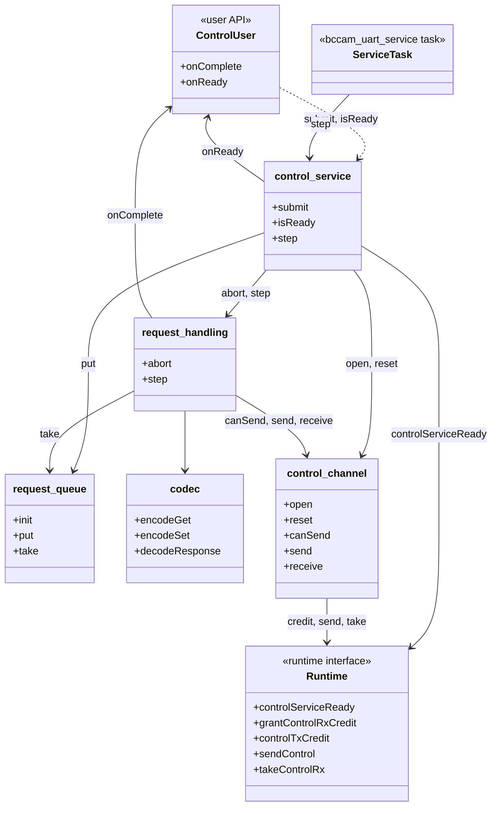
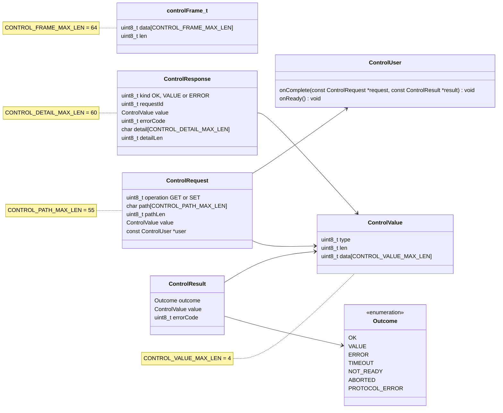
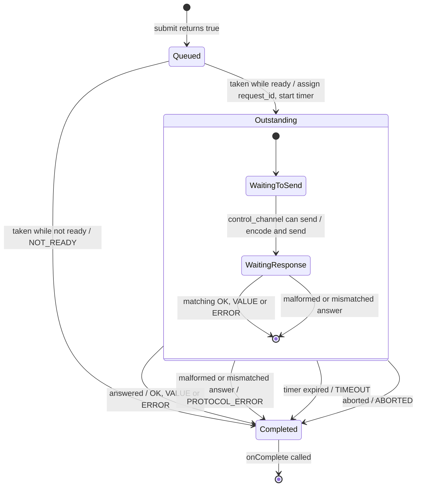
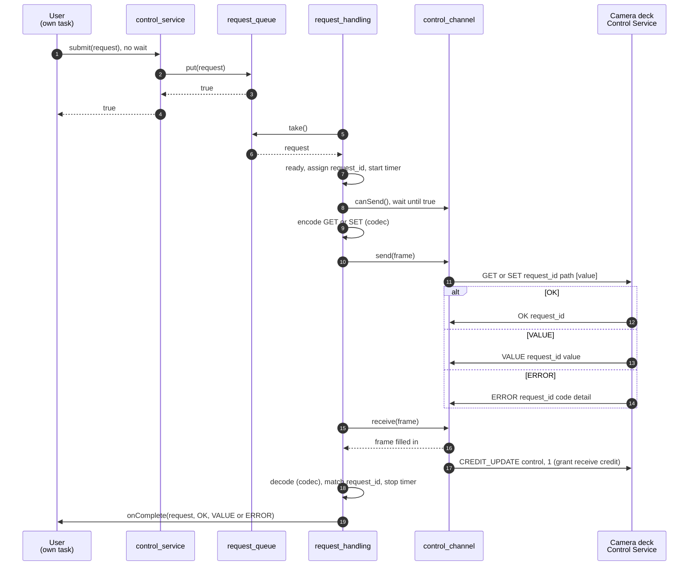
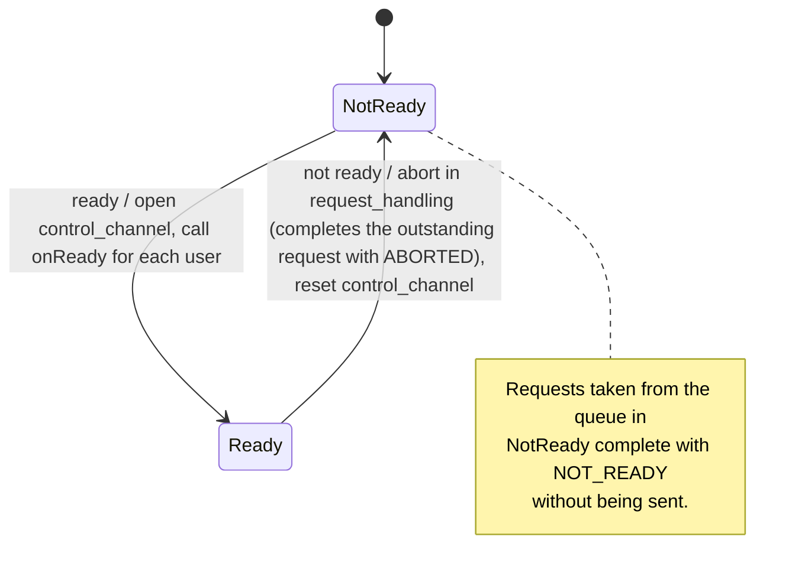
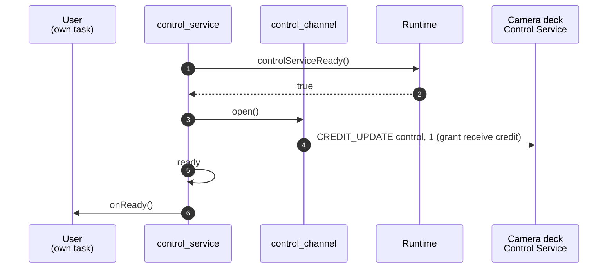
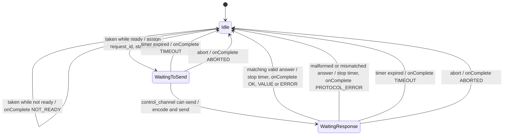
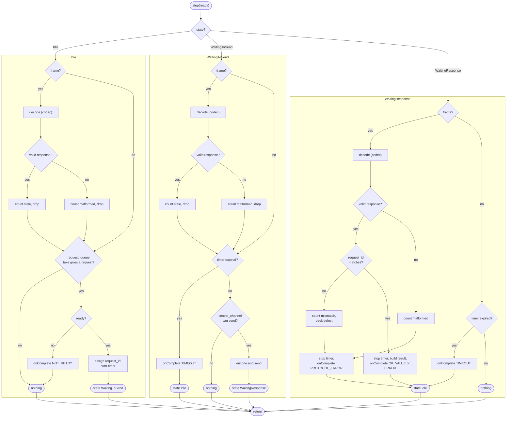
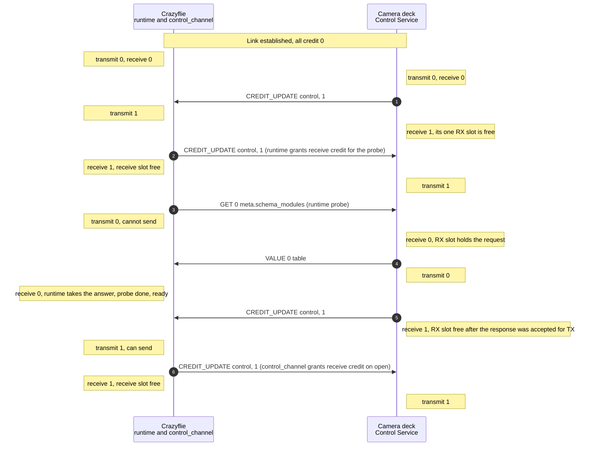

Design of the Control Service on the Crazyflie side of the UART link to the
camera deck.

The wire format is defined by the Control Service protocol in
camera-deck-firmware (`docs/protocol/common/control-service.md`). This page
summarizes the layout of the frames in scope, see "Frame layout". Where they
differ, the protocol document is the authority.

## Scope

In scope, matching `bitcraze.control` version 0.0 on the deck:

- the requests `GET` and `SET`,
- the responses `OK`, `VALUE` and `ERROR`,
- the value types `bool`, `u8`, `i8`, `u16`, `i16`, `u32` and `i32`,
- one request outstanding at a time.

Out of scope: `CMD`, `NOTIFY`, more than one request in flight, path handles,
listing paths and chunking. The probe is also out of scope. The runtime runs
it before the Control Service takes over, see "Ready".

## Terms

The terms build on Frame-Slot Credit in the Common Link. Credit is per
service and per direction. Here they are used for the Control service, seen
from the Crazyflie.

- **Frame**: one Control message, the payload of one UART packet on the
  Control service. The runtime removes the UART packet envelope, so a frame
  starts with `kind`. A frame has no length field of its own. Its length is
  the UART packet's `payload_length`, at most the Link MTU. See "Frame
  layout".
- **Transmit credit**: Frame-Slot Credit the deck has given the Crazyflie.
  One credit allows the Crazyflie to send one Control frame.
- **Receive credit**: Frame-Slot Credit the Crazyflie has given the deck.
  One credit allows the deck to send one Control frame.
- **Receive slot**: local space for one received Control frame. Receive
  credit is never more than the number of free receive slots.
- **Grant receive credit**: the Crazyflie makes a free receive slot
  available to the deck. Freeing the slot and telling the deck always happen
  together.
- **Bound**: the Control service is bound when the catalog advertises a
  compatible `bitcraze.control` and the Crazyflie has taken its handle. This
  is Service Binding in the Common Link. It lasts until the deck resets, the
  link faults or the handle changes.
- **Ready**: the Control service is bound and the probe has been answered
  with `VALUE`. User requests are only sent while ready.
- **Probe**: the `GET 0 meta.schema_modules` request the runtime sends on
  the Control service before ready. The Control Service only observes the
  result.
- **Lifecycle**: the states of something that is created and ends, and goes
  through them once, such as a request from `submit` to `onComplete`.
- **State machine**: the states of something that lives as long as the
  system and moves between them repeatedly, such as `control_service`.
- **Unit**: one `.c` and `.h` pair with its own interface and its own host
  test. The Control Service layer consists of units.

### Frame layout

Every frame in scope starts with the same two bytes, followed by a body that
depends on `kind`:

| Byte | Field | Content |
|---|---|---|
| 0 | `kind` | `GET` 0x01, `SET` 0x02, `OK` 0x80, `VALUE` 0x81, `ERROR` 0x82. Bit 7 is set in frames from the deck. |
| 1 | `request_id` | Set by the Crazyflie in the request, copied by the deck into the answer. |
| 2.. | body | Depends on `kind`, see below. |

Bodies:

| `kind` | Body |
|---|---|
| `GET` | `path_len:u8`, `path` |
| `SET` | `path_len:u8`, `path`, `value` |
| `OK` | empty |
| `VALUE` | `value` |
| `ERROR` | `error_code:u8`, `detail_len:u8`, `detail` |

- `value` is `type:u8`, `len:u8`, `data[len]`. Multi-byte integers are
  little-endian.
- `path` is ASCII, `path_len` bytes, not NUL-terminated.
- A frame shorter than 2 bytes has no `request_id` and is malformed.
- `NOTIFY` (0xc0) is out of scope. It has no `request_id`: byte 1 is
  `path_len`.

## Layers

A layer is a level of the design with its own responsibility. It talks only
to the layer directly above and the layer directly below, through a defined
interface.

| Layer | Responsibility | Scope |
|---|---|---|
| Users, for example camera settings | Decide what to `GET` and `SET` | Out of scope. Only the API they call is defined. |
| Control Service | Turns user requests into Control frames and back. Handles readiness, timeouts and credit. | In scope |
| Runtime and Common Link | Bytes, frames, session, catalog, Service Binding, credit accounting and the probe | Out of scope. Only the interface the Control Service uses is defined. |

This page describes the Control Service layer and its two interfaces: the
user API above and the runtime interface below.

## Units

The Control Service is broken down into five units by responsibility.
`control_service` is above the other four and coordinates them.

| Unit | Responsibility | Runs in |
|---|---|---|
| `control_service` | The only unit users see: `submit` and `isReady`. The single entry point the service task steps. Holds the ready flag, observes ready and not ready from the runtime, and tells the other units what to do in a fixed order on each: opens and resets `control_channel`, aborts in `request_handling`, calls `onReady`, and steps `request_handling`. Passes `submit` on to `request_queue`. | Service task. `submit` and `isReady` are also called from user tasks. |
| `request_queue` | Hands submitted requests from user tasks to the service task. `put` does not block and returns false when the queue is full. | User tasks, through `control_service`, and the service task |
| `request_handling` | Handles one outstanding request: `request_id`, timer, waiting until it can send, decoding with `codec`, telling a match, a stale answer and a malformed frame apart, and calling `onComplete`. Sends requests only while ready. | Service task |
| `codec` | Encodes `GET` and `SET`, and decodes and validates `OK`, `VALUE` and `ERROR`. Pure functions without state. | Service task |
| `control_channel` | The only unit aware of the receive slot and credit. Grants the first receive credit when opened, resets when told, tells whether a frame can be sent, sends raw frames, and copies a received frame out of the receive slot and grants receive credit at once. | Service task |

The sections from "Structure" to "Error handling" cover more
than one unit. Each unit then has its own section.

## Structure

The units, the user API above them and the runtime interface below them.
The Control Service runs in the bcCam UART service task. Users submit
requests from their own task.

Function names in the diagrams are descriptive and not decided as C
identifiers. The diagram shows names only. The signatures and fields are in
"User API", "Runtime interface" and each unit's section.

The data passed through the user API, and the frame and response passed
between the units:

`controlFrame_t` holds one frame, including its bytes. Assumption: the Link
Maximum Transmission Unit (MTU) is 64.

- `len` is the number of valid bytes in `data`, from 0 to
  `CONTROL_FRAME_MAX_LEN`. It replaces the UART packet's `payload_length`.
- `CONTROL_FRAME_MAX_LEN` is the Link MTU of the UART profile. `len` fits
  in a `uint8_t` because the MTU is at most 255.
- Where a diagram on this page says `frame`, it means a `controlFrame_t`.

The other types hold their data inline, sized so that every request and
response fits in one frame:

- `CONTROL_VALUE_MAX_LEN` is 4, the size of the largest value type in
  scope, `u32` and `i32`. `len` is the number of valid bytes in `data`.
- `CONTROL_PATH_MAX_LEN` is 55: a `SET` frame has 2 header bytes,
  `path_len`, the path and a value of at most 2 + 4 bytes. A request with a
  longer path cannot be built. `path` is ASCII, `pathLen` bytes, not
  NUL-terminated.
- `CONTROL_DETAIL_MAX_LEN` is 60: an `ERROR` frame has 2 header bytes,
  `error_code` and `detail_len` before the detail. `detail` is UTF-8 text,
  `detailLen` bytes, not NUL-terminated.
- `ControlResponse.value` is valid only when `kind` is `VALUE`, and
  `errorCode` and `detail` only when `kind` is `ERROR`.
- `user` points to a static `ControlUser` that outlives every request. The
  path and value are copied, so the user can drop its request when `submit`
  returns.
- `ControlUser` holds two function pointers, `onComplete` and `onReady`.
  There is no context pointer: each user has its own `ControlUser` and its
  own callbacks, and `onComplete` gets the request, whose `user` tells which
  user it belongs to.

### User API

Users see only the user API: `submit` and `isReady` on `control_service`,
see "control_service", and their own `onComplete` and `onReady` in their
`ControlUser`.

| Function | Called by | What it does |
|---|---|---|
| `onComplete(const ControlRequest *request, const ControlResult *result) void` | `request_handling`, in the service task | Tells the user that a request has completed, with its result. |
| `onReady() void` | `control_service` on ready, in the service task | Tells the user that requests can be submitted. |

- `onComplete` and `onReady` are called in the service task. They must not
  block.
- Every submitted request gets exactly one `onComplete`.
- `onComplete` is called through the request's `user`, by
  `request_handling`, which owns the request lifecycle. `onReady` goes to
  every user and is called by `control_service`.

### Runtime interface

The functions of the runtime that the Control Service uses.

| Function | Called by | What it does |
|---|---|---|
| `controlServiceReady() bool` | `control_service` in its step | Returns true when the Control service is bound and the runtime's probe has been answered with `VALUE`. Turns false when the binding is lost. |
| `grantControlRxCredit() void` | `control_channel` in `open` and `receive` | Grants one receive credit to the deck. Does not fail temporarily, see "Credit". |
| `controlTxCredit() uint8_t` | `control_channel` in `canSend` | Returns the transmit credit. |
| `sendControl(const controlFrame_t *frame) void` | `control_channel` in `send` | Sends a frame on the Control service, using one transmit credit. |
| `takeControlRx(controlFrame_t *frame) bool` | `control_channel` in `receive` | Copies a received frame out of the receive slot into `frame`. Returns true when a frame was taken. Returns false when the receive slot was empty, and `frame` must not be used. |

- Only `control_channel` uses the credit and receive slot functions of the
  runtime interface.

## Request lifecycle

The lifecycle of one request, from `submit` to `onComplete`. One request is
outstanding at a time. The timeout starts when the request is taken from
the queue, so it also covers waiting until a frame can be sent.

- A request for which `submit` returns false never enters the lifecycle.
- A late answer to a request that timed out arrives while no request is
  outstanding or while the next request is in WaitingToSend, never in
  WaitingResponse. This follows from the ordering guarantee of
  `control_channel`, see "control_channel".

### Sequence for request with an answer

A user submits a request and the deck answers it. Frames between
`control_channel` and the deck go through the runtime and the link. This
diagram describes the full lifecycle including all control service units.

## Error handling

The cases in which a request does not get a matching answer, and what the
user gets.

| Case | Detected by | Handling | User gets |
|---|---|---|---|
| No answer before the timeout | `request_handling`, timer | Completes the request. Receive credit stays granted. | `TIMEOUT` |
| Late answer to a request that timed out | `request_handling`, no request in WaitingResponse | Counts it as stale and drops it. | Nothing more, the request already got `TIMEOUT` |
| Malformed answer in WaitingResponse | `codec` | Counts it as malformed and completes the request. The frame is the answer, so no other answer will follow. | `PROTOCOL_ERROR` |
| `request_id` mismatch in WaitingResponse | `request_handling` | Counts it as a mismatch, a deck defect, and completes the request. The frame is the answer, so no other answer will follow. | `PROTOCOL_ERROR` |
| Malformed frame in Idle or WaitingToSend | `codec` | Counts it as malformed and drops it. | Nothing, no request is waiting for an answer |
| Ready lost with a request outstanding: deck reset, link fault or handle change | `control_service`, `controlServiceReady()` is false | Aborts in `request_handling`, then resets `control_channel`. | `ABORTED` |
| Request taken from the queue while not ready | `request_handling`, stepped with ready false | Completes the request without sending it. | `NOT_READY` |
| Queue full | `request_queue`, `put` | `submit` returns false. | No `onComplete` |

A late answer can never complete the next request. `control_channel` lets
the next request be sent only when the deck has given transmit credit
again, and the deck does that only after its answer to the previous request
has been accepted for transmission. The link delivers frames in order, so
the late answer arrives before the next request is sent, while it is in
WaitingToSend. See "Credit" under "control_channel".

## control_service

The unit above the other four. It is the only unit users see, through
`submit` and `isReady`, and the single entry point the service task steps.
`submit` passes the request on to `request_queue` and does not block. The
Control Service is ready when the runtime reports
`controlServiceReady()`: the Control service is bound and the runtime's
probe has been answered. User requests are only sent while it is ready.
`control_service` observes ready and not ready and tells the other units
what to do, in a fixed order on each. The other units do not know about
ready and not ready. `request_handling` gets the ready flag as an argument
to its step.

- Order on ready: `control_service` opens `control_channel` with `open`,
  which grants receive credit, then calls `onReady` for each user.
- Order on not ready: `control_service` tells `request_handling` to
  `abort`, which completes the outstanding request with `ABORTED`, then
  resets `control_channel` with `reset`, and goes to not ready. Requests
  taken from the queue after that complete with `NOT_READY`.
- The ready flag is written only in the service task. Users read it with
  `isReady` from their own task.

### Functions

| Function | Called by | What it does |
|---|---|---|
| `submit(const ControlRequest *request) bool` | Users, from their own task | Passes the request on to `request_queue` with `put`, without blocking. Returns false when the queue is full, and the request is not queued. |
| `isReady() bool` | Users, from their own task | Returns the ready flag. |
| `step() void` | The service task, once per service step | Observes `controlServiceReady()`, acts on ready and not ready in the order above, and steps `request_handling` with the ready flag. |

### Data

| Field | Type | What it holds |
|---|---|---|
| `ready` | `bool` | The ready flag. Written only in the service task. |

### State machine

### Ready

The runtime establishes the link, enumerates the catalog and runs the
probe. The flow starts when `control_service`, in its step, finds that the
runtime reports `controlServiceReady()` as true. It opens `control_channel`
and calls `onReady` for each user. Users can then submit requests as in
"Request with an answer". Frames between `control_channel` and the deck go
through the runtime and the link.

## request_queue

Hands submitted requests from user tasks to the service task. `put` is
called from user tasks, through `control_service`. `take` is called from
the service task, by `request_handling`.

### Storage

- The requests are stored in a FreeRTOS queue in static memory, the same
  pattern as the request queue in `bccam_uart_service`.
- The queue holds 4 requests.
- Each entry is a copy of the whole `ControlRequest`, including its
  `value`. The user can reuse or drop its request as soon as `submit`
  returns.
- `take` copies the request out to `request_handling`, which keeps it
  while the request is outstanding. The `request` passed to `onComplete`
  is that copy, not the user's original.
- The FreeRTOS queue makes `put` and `take` safe between tasks.
  `request_queue` has no lock of its own.
- The service task is not notified when a request is put. It finds the
  request the next time it polls the queue, within its idle wait.
- The queue is not cleared when ready is lost.

### Functions

| Function | Called by | What it does |
|---|---|---|
| `init() void` | Startup, before the first `put` | Creates the queue. |
| `put(const ControlRequest *request) bool` | `control_service` in `submit`, from user tasks | Copies the request into the queue without blocking. Returns false when the queue is full, and the request is not queued. |
| `take(ControlRequest *request) bool` | `request_handling` in its step, in the service task | Copies the oldest request out of the queue without blocking. Returns false when the queue is empty. |

Requests are taken in the order they were put.

## request_handling

The unit request_handling is the main responsible unit for the request
lifecycle: taking requests off the queue, sending, receiving the answer
and calling the `onComplete` function.

The unit is stepped by control_service, once per service step.

Handles one outstanding request at a time. It sends requests only while
ready. It calls `codec` to encode requests and to decode and validate
answers.

- `request_id` is incremented for each request and wraps at 255. In
  WaitingResponse it is a check: a mismatch means a deck defect, not a
  late answer. Starts at 1 (since one request is needed to make the 
  control service ready, part of runtime).

### Functions

| Function | Called by | What it does |
|---|---|---|
| `abort() void` | `control_service` on not ready | Completes the outstanding request with `ABORTED` and goes to Idle. Does nothing in Idle. |
| `step(bool ready) void` | `control_service` in its step, once per service step | Does one step, see "One step". |

### Data

| Field | Type | What it holds |
|---|---|---|
| `outstanding` | `ControlRequest` | The copy of the outstanding request, taken from `request_queue`. Passed to `onComplete`. |
| `nextRequestId` | `uint8_t` | The `request_id` for the next request. Starts at 1 and wraps at 255. |
| `deadline` | Not decided | When the outstanding request times out. |

### State machine

### One step

What `request_handling` does in one call to `step(ready)`, from start to
return. Each state has its own swim lane. Each lane starts by decoding
a received frame with `codec` - the receive mechanism depends on that all
received frames are handled, even the unwanted ones. A lane ends either without
changing the state or by setting a new state, which takes effect from the
next step. `control_channel` has already granted receive credit for a
received frame, so no branch has to.

Assumptions:

- `control_channel` grants one receive credit at a time.
- `control_channel` lets a request be sent only after any answer to the
  previous request has been delivered, see "Request lifecycle".
- The deck sends exactly one answer per request.
- Every frame from the deck is an answer. This no longer holds if `NOTIFY`
  is brought into scope.

Consequences and design choices:

- At most one frame is received per step, since there is never more than
  one frame to take.
- Receiving comes before the timeout check, so an answer that arrives in
  the same step as the deadline completes the request.
- In WaitingResponse, any received frame is the answer to the outstanding
  request. A malformed answer or a `request_id` mismatch therefore
  completes the request at once with `PROTOCOL_ERROR` instead of waiting
  for the timeout, since no other answer will follow.
- `codec` treats `NOTIFY` as malformed. If `NOTIFY` is brought into scope,
  a `NOTIFY` in WaitingResponse would wrongly complete the request with
  `PROTOCOL_ERROR`. `NOTIFY` must then be told apart from a malformed
  answer and not complete the request.
- At most one request is taken from the queue per step, also when it
  completes with `NOT_READY`.
- A request moves at most one state per step. A request taken in one step
  is sent at the earliest in the next step, and the next request is taken
  at the earliest in the step after the previous one completed.

## codec

Encodes `GET` and `SET`, and decodes `OK`, `VALUE` and `ERROR` and
validates their bodies. Pure functions without state. 

### Functions

| Function | What it does |
|---|---|
| `encodeGet(uint8_t requestId, const char *path, uint8_t pathLen) controlFrame_t` | Builds a `GET` frame as in "Frame layout". |
| `encodeSet(uint8_t requestId, const char *path, uint8_t pathLen, const ControlValue *value) controlFrame_t` | Builds a `SET` frame as in "Frame layout". |
| `decodeResponse(const controlFrame_t *frame, ControlResponse *response) bool` | Validates the frame. Returns true and fills in `response` when the frame is valid. Returns false when it is malformed, and `response` must not be used. |

A valid `response` holds `kind`, `request_id` and the body. A
frame is malformed when:

- it is shorter than 2 bytes,
- `kind` is not `OK`, `VALUE` or `ERROR`, which includes `NOTIFY`,
- the body does not match "Frame layout" for the `kind`, or bytes remain
  after it.

## control_channel

The only unit aware of the receive slot and credit. It works with raw
frames only and does not know the Control message format.

- On `open`, it grants the first receive credit. The runtime's probe
  leaves receive credit at 0 when it is done.
- On `reset`, it clears the receive buffer and its credit state.
- It tells whether a frame can be sent, which hides the transmit credit.
- On receive, it copies the frame out of the receive slot into the caller's
  `controlFrame_t` and grants receive credit at once.
- It guarantees that a frame can be sent only after any answer to the
  previous request has been delivered. `request_handling` relies on this to
  recognize stale answers.

### Functions

| Function | Called by | What it does |
|---|---|---|
| `open() void` | `control_service` on ready | Grants the first receive credit. |
| `reset() void` | `control_service` on not ready | Clears the receive buffer and the credit state. |
| `canSend() bool` | `request_handling` in WaitingToSend | Returns true when a frame can be sent, that is when there is transmit credit. |
| `send(const controlFrame_t *frame) void` | `request_handling` in WaitingToSend | Sends the raw frame. |
| `receive(controlFrame_t *frame) bool` | `request_handling` at the start of each step | Copies a received frame out of the receive slot into `frame` and grants receive credit at once. Returns true when a frame was received. Returns false when there was none, and `frame` must not be used. |

### Data

| Field | Type | What it holds |
|---|---|---|
| `rxBuffer` | `controlFrame_t` | The receive buffer. Cleared on `reset`. |

### Credit

How the Control service's transmit credit and receive credit change from
link establishment, through the runtime's probe, until `control_channel` is
opened and both sides have credit again. This is why `control_channel` can
guarantee that a frame can be sent only after any answer to the previous
request has been delivered, also for the first request after the probe.

There is no negotiation. Each receiver grants credit for its free receive
slots with `CREDIT_UPDATE`, and each sender uses one credit per frame. The
deck has one Control RX slot and grants credit again only after its response
has been accepted for transmission. The link delivers frames in order, so
transmit credit 1 means that the deck is ready for the next request and that
its answer to the previous one has already arrived.

- Steps 1 and 2 can come in either order, and so can steps 5 and 6.
- The runtime does not grant receive credit again after the probe answer.
  `control_channel` grants it on `open`, after `control_service` has seen
  ready.
- After a timeout, the receive credit stays granted. Either the late answer
  uses it, and receive credit is granted again when it is received, or the
  next request finds it already granted.
- `grantControlRxCredit` does not fail temporarily. When the grant cannot be
  sent at once, the runtime keeps it pending and sends it on a later step.
  A request sent while a grant is pending waits for its answer until the
  grant is sent, within its timeout.

## Open questions

Does this design support the full chain control service, from deck to cflib? Because it is created with the temporary param path in mind.

TODO: Add public functions to all units

TODO: Rename everything to C style naming, fulfilling naming conventions